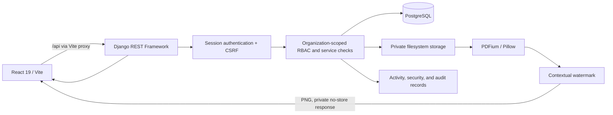
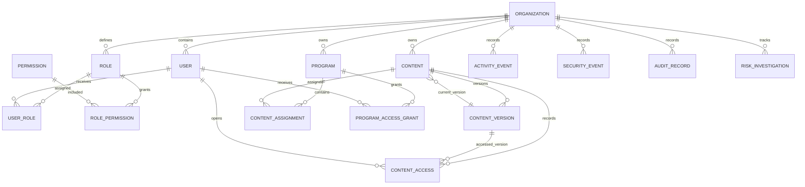
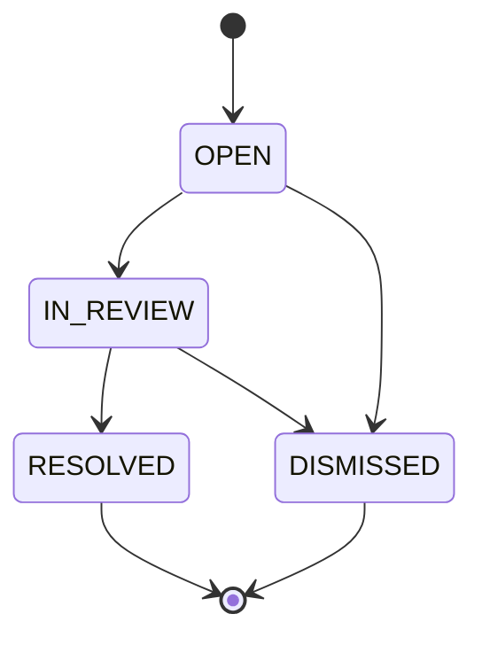

# AEGIS — Implementation and Viva Guide

## Purpose and evidence rules

This guide explains the implementation present in this repository and provides
a technical demonstration/viva reference. It is not a replacement for the
authoritative requirements, architecture decision records, detailed API
contracts, or local setup instructions linked below.

Claims are deliberately limited to source and test evidence. “Implemented” does
not mean authenticated manual acceptance has been completed. The latest
backend verification recorded for this review is 174 passing tests against
Django's disposable PostgreSQL test database. The latest recorded frontend
verification is 23 passing tests and a successful Vite production build.
Authenticated browser acceptance and genuine screenshots remain outstanding.

## 1. Project overview

AEGIS (Enterprise Knowledge Protection and Delivery Platform) is a
multi-organization content governance application. Its core concern is
controlled access to versioned enterprise content: who may manage or preview
it, which consumers may receive it, whether the current publication/grant/
assignment state still permits delivery, and what operational evidence should
be retained.

The system is a **React + Django REST Framework + PostgreSQL** application
with organization-private source-file storage. The current viewer converts
supported PDFs and raster images into watermarked page images. A source file
is not exposed through a public storage URL.

The three scope-expansion capabilities are limited to:

1. **Context-aware content access-policy scope:** request-time, explainable,
   rule-based risk signals derived from existing records. Signals are advisory;
   they do not grant, deny, or revoke access.
2. **Content Exposure Risk Investigation:** an authorized, audited case
   workflow that references current organization-scoped Security Events and
   Audit Records.
3. **Permission-aware enterprise knowledge assistant scope:** live search over
   authorized Content titles and descriptions with metadata citations. It is
   retrieval-only; no document text extraction, semantic search, generative
   model, or external AI service is implemented.

## 2. Scope and source-of-truth documents

Read these documents before changing behavior:

| Document | Purpose |
|---|---|
| `docs/scope-expansion-implementation-guide.md` | Approved incremental implementation approach and capability boundaries |
| `docs/scope-expansion-implementation-task.md` | Approved scope, acceptance expectations, and implementation task |
| `docs/implementation-status.md` | Current handoff, test and migration evidence, known gaps, and next actions |
| `docs/implementation-setup.md` | Current Windows local setup and manual test procedure |
| `docs/api-specification.md` | Detailed API contracts, permissions, and error behavior |
| `docs/functional-architecture.md` | Module responsibilities and interactions |
| `docs/data-architecture.md` | Data model and tenancy principles |
| `docs/adr/` | Accepted architecture decisions, including privileged preview |
| `Agent/Rules/rules/aegis-development.mdc` and applicable `Agent/` files | Project development, security, testing, and documentation rules |

If this guide and a source implementation or later approved decision differ,
verify the discrepancy and update the documentation; do not assume this guide
overrides the implementation or an accepted ADR.

## 3. Architecture



### Runtime responsibilities

- **Frontend:** `frontend/src/App.jsx` renders login, navigation, protected
  modules and the viewer. `frontend/src/api.js` centralizes API calls and
  session/CSRF handling. `frontend/src/App.test.jsx` contains UI tests.
- **API routing:** `backend/config/urls.py` and
  `backend/config/api_urls.py` mount the versioned API. Feature route files are
  `backend/identity/urls.py`, `backend/knowledge/urls.py`, and
  `backend/accountability/urls.py`.
- **Identity/RBAC:** `backend/identity/` owns Organizations, Users, roles,
  permissions, login, effective-permission checks, and user administration.
- **Knowledge and delivery:** `backend/knowledge/` owns Content, versions,
  Programs, assignments, grants, upload validation, private storage, page
  rendering, metadata retrieval, risk-signal rules, and analytics.
- **Accountability:** `backend/accountability/` owns activity, security events,
  audit records, login throttling records, investigations, evidence validation,
  and their APIs.
- **Persistence:** PostgreSQL stores application and audit metadata. Django
  migrations are the schema source of truth.
- **Files:** the configured private filesystem storage root holds uploaded
  bytes; PostgreSQL stores associated metadata and a storage key.

Docker Compose supplies PostgreSQL for local development; Django and Vite are
started separately. Do not infer that Docker Compose is the production
deployment architecture.

## 4. Main modules and responsibilities

| Module | Main responsibility | Representative source |
|---|---|---|
| Login/session | Organization slug + email + password; session and CSRF | `backend/identity/views.py`, `backends.py` |
| RBAC | Effective permissions through organization role assignments | `backend/identity/rbac.py`, `permissions.py` |
| User administration | Tenant-scoped user CRUD supported by the API and role assignment at creation | `backend/identity/views.py`, `serializers.py` |
| Content | Metadata and lifecycle APIs | `backend/knowledge/views.py`, `services.py` |
| Upload/storage | File validation, private key construction, checksums and size | `backend/knowledge/file_uploads.py`, `storage.py` |
| Versioning | Draft/published/archived versions and current-version selection | `backend/knowledge/models.py`, `services.py` |
| Program access | Programs, Content assignments, grants, expiry, revocation | `backend/knowledge/models.py`, `services.py`, `access.py` |
| Secure viewer | Authorize, render, watermark, and reauthorize page delivery | `backend/knowledge/delivery.py`, `views.py` |
| Privileged preview | Separate operator preview permission and audit path | `backend/knowledge/delivery.py`; ADR-011 |
| Risk signals | Derived advisory rules over normal access/denial records | `backend/knowledge/risk_signals.py` |
| Investigations | Tenant-scoped cases, evidence references and audit | `backend/accountability/evidence.py`, `services.py`, `views.py` |
| Knowledge retrieval | Permission-aware metadata search and citations | `backend/knowledge/retrieval.py`, `views.py` |
| Analytics/reports | Scoped aggregations and export/report data | `backend/knowledge/analytics_views.py` |
| UI | Role-gated navigation and module workflows | `frontend/src/App.jsx`, `frontend/src/api.js` |

## 5. Authentication, authorization, and tenant isolation

### 5.1 Authentication flow

1. The client obtains a CSRF token from `GET /api/v1/auth/csrf/`.
2. The client submits the organization slug, email, and password to
   `POST /api/v1/auth/login/`, including the CSRF header.
3. `OrganizationEmailBackend` resolves a user within the named organization
   and checks the password using Django's password-hashing functions.
4. Django creates a session. Protected API requests use
   `SessionAuthentication`; unsafe requests require CSRF validation.
5. `GET /api/v1/auth/me/` returns the current user and effective permissions
   used to render the frontend.
6. `POST /api/v1/auth/logout/` ends the session.

This is cookie/session authentication, not JWT or bearer-token authentication.
Settings configure HttpOnly cookies, SameSite behavior, secure cookies outside
debug mode, and session lifetime. The exact settings are in
`backend/config/settings.py`; deployment-specific cookie/origin settings must
be verified for the target environment.

### 5.2 Password and login throttling

Failed login attempts are recorded by
`backend/accountability/services.py`. The current implementation uses hashed
account/IP keys and a PostgreSQL-backed, transactionally locked rolling window:

- account threshold: 5 failed attempts in 15 minutes;
- source-IP threshold: 20 failed attempts in 15 minutes;
- block duration: 15 minutes.

The normal login response does not reveal whether an account or organization
exists. Login success/failure and rate-limit state are represented by security
events/counters. The UI should be manually checked to confirm rate-limit
responses are understandable and do not expose sensitive account detail.

### 5.3 RBAC and default roles

Permissions are catalogued in `identity.models.Permission`. Effective access
is computed from the current user's organization-scoped `UserRole` assignments
and each role's `RolePermission` rows. The frontend may hide unavailable
controls, but backend permissions and domain rules are authoritative.

The `seed_rbac` command provisions the standard organization roles:

- **Administrator:** broad organization administration and management access.
- **Content Manager:** content, version, Program, assignment, preview, and
  related operational permissions as seeded.
- **Content Consumer:** constrained search and secure consumer delivery when
  assignment and grant rules are also satisfied.
- **Management:** organization-level read/report permissions as seeded.

Check `backend/identity/management/commands/seed_rbac.py` and the actual
permission catalogue for the definitive mapping; do not infer permission from
the role label. Role editing/permission mutation should not be assumed to be
available as a general-purpose UI just because list endpoints exist.

### 5.4 Organization isolation

Most tenant-owned records carry an `organization_id`; API querysets filter by
the authenticated user's organization, and services validate related records
before mutation. Foreign keys, unique constraints, and check constraints
provide additional database integrity.

The repository implements **logical application-level tenant isolation** in a
shared PostgreSQL database. No PostgreSQL Row-Level Security policy was found.
Some cross-model tenant consistency is enforced by model/service validation
rather than compound database constraints; privileged direct database writes
are outside the ORM-level enforcement boundary.

**Lifecycle gap:** Organization has `ACTIVE`, `SUSPENDED`, and `ARCHIVED`
statuses, but the inspected authentication backend does not filter on
Organization status. Whether non-active organizations must be blocked is an
unresolved product/security decision; do not claim that this is enforced.

## 6. Data model and relationships

The diagram below is an implementation overview rather than an exhaustive ER
diagram. Fields, constraints, and migrations are maintained in the model and
migration files.



### Key domain concepts

- **Organization:** tenant boundary.
- **User / Role / Permission:** identity and effective authorization.
- **Content:** tenant-owned metadata and lifecycle state.
- **ContentVersion:** file metadata, version number/state, storage key, MIME,
  size, and checksum. `Content.current_version` indicates the currently
  published version where the lifecycle permits it.
- **Program / ContentAssignment:** access grouping and content inclusion.
- **ProgramAccessGrant:** per-user Program access state and optional expiry.
- **ContentAccess:** records a granted/denied attempt and its consumer/preview
  context, content, version, user, Program and time where applicable.
- **ActivityEvent:** operational viewer events such as opened and page rendered.
- **SecurityEvent:** authentication and authorization-related events.
- **AuditRecord:** actor/action/resource/metadata records for audited changes.
- **RiskInvestigation:** status, severity, notes and bounded JSON evidence
  references. Evidence rows themselves are not copied into the investigation.
- **AuthenticationRateLimitCounter:** hashed-key failure timestamps and block
  state; raw credentials are not stored in the counter key.

### Integrity and retention observations

Audit records reject update/delete through the application's ORM layer and
investigation mutations are committed atomically with their audit records.
This is not a cryptographic hash-chain or a database-trigger guarantee against
a privileged database owner. Source evidence uses protected relationships and
is not deleted as part of normal investigation editing. Uploaded bytes are
identified by SHA-256 and size metadata; the checksum detects mismatch, not
malware or authenticity of the original author.

## 7. Content upload, versioning, and private storage

1. A permitted Content Manager creates Content metadata.
2. A draft version is uploaded through the content/version API.
3. Upload validation checks supported extension, declared MIME type, file
   signature or package structure, and configured size/pixel limits.
4. `StorageService` writes bytes under a tenant/content/version-scoped key in
   the configured private storage root and records the byte count and SHA-256
   digest.
5. A permitted user publishes a version. Service logic updates the current
   version and prior version lifecycle in a transaction.
6. A new version is a separate record and file; historical versions are not
   silently overwritten.

The default private storage root is configured by
`AEGIS_PRIVATE_STORAGE_ROOT`. Storage URLs are disabled. The viewer currently
supports PDF and raster image rendering. A file format accepted for storage
is not necessarily supported for protected rendering: PowerPoint/video
delivery is not implemented. Upload validation is not a virus scanner,
document sanitization system, or DRM.

## 8. Secure delivery and privileged preview

### 8.1 Consumer delivery

At access start, `start_content_access` checks that:

- the authenticated user is active;
- Content belongs to the user's organization and is published;
- the current ContentVersion is published;
- the Program belongs to the organization and is active;
- the user has an active, unexpired ProgramAccessGrant; and
- the Content is assigned to that Program.

It creates a consumer-context `ContentAccess` and corresponding opened
activity event. On each page request, delivery rechecks the access record,
same user/organization/content, published/current version, active Program,
active user, current grant and assignment. Revoking a grant or changing
publication/assignment/version state therefore prevents later page requests;
the server does not rely solely on checks made when a viewer was first opened.

Pages are rendered and returned as PNG with private/no-store caching behavior.
The source file is not returned. The watermark includes contextual identity,
organization, time, content/version context and preview context where
applicable. Watermarking is deterrence and attribution, not prevention of
screenshots or screen recording.

### 8.2 Privileged preview

Administrator and Content Manager preview is a **separate operator path**
authorized by `CONTENT_PREVIEW` together with Content and version view
permissions. It can preview eligible draft/published content versions without
requiring consumer assignment/grant. It writes a preview-context access and
activity record and a `CONTENT_PREVIEW_STARTED` audit record. Preview does not
create consumer entitlement, assignment, or grant. Every page request
revalidates preview eligibility and the selected version.

The split follows `docs/adr/0011-privileged-content-preview.md`; preview is not
a bypass of `SECURE_DELIVERY`. Authenticated browser acceptance is still
needed for end-to-end confirmation.

## 9. Activity, security events, audit, and analytics

- **ActivityEvent** records viewer lifecycle activity (opened and page
  rendered), including the relevant access context. It is not a complete
  record of every user interaction.
- **SecurityEvent** records login successes/failures, throttling and access
  denials. The risk-denial signal uses the normal content denial event fields.
- **AuditRecord** records selected business mutations, such as content,
  publication, grant, user/role, preview and investigation actions.
- These systems are distinct because they answer different questions:
  operational interaction, security observation, and attributable mutation.

Analytics are computed from persisted access records. Successful consumer
access starts—not page-render events—are the unit for access counts. Distinct
active users are distinct user IDs in the selected period; most-viewed content
is grouped and ordered by access count (with deterministic content ordering);
daily counts group access-start timestamps by date; version usage groups by
content/version. Preview-context rows are excluded from consumer metrics.
These are counts/groupings, not inferred averages, percentages, risk scores,
or AI predictions. Consult `backend/knowledge/analytics_views.py` and
`docs/api-specification.md` for exact response payloads and scope filters.

## 10. Capability A — explainable advisory risk signals

### Inputs and rules

`backend/knowledge/risk_signals.py` derives signals on request; there is no
separate persistent RiskSignal model or duplicate event logger.

| Signal | Source record and qualifying window | Current rule | Severity | Meaning |
|---|---|---|---|---|
| `REPEATED_DENIALS` | Same-organization `SecurityEvent` rows, `event_type=ACCESS_DENIED`, `resource_type=content`, known user; rolling 24 hours | At least 3 qualifying denial records | MEDIUM | Repeated denied content attempts were observed |
| `ACCESS_BURST` | Same-organization `ContentAccess` rows with `access_result=GRANTED`, consumer context; rolling 24 hours | At least 4 access starts across at least 3 distinct Content IDs | LOW | One user opened multiple distinct content items |

The API accepts optional start/end filter values; invalid or reversed ranges
must be rejected through API validation. Its implementation groups by
organization and user, finds a qualifying rolling window, returns event
counts/times and an explanation, and derives a summary by type and severity.
The current threshold/severity values are observable implementation rules,
not validated real-world risk levels or independently measured policy.

### Trust boundary and evaluation

These signals **must not** make authorization decisions. Their presence or
absence does not grant or deny content; access remains governed by current
identity, RBAC, publication, assignment, grant, and version checks.

Automated tests use controlled synthetic records to verify threshold
boundaries, window inclusion, source filtering, tenant isolation, permissions,
invalid dates and no authorization-state mutation. They provide regression
evidence, not true-positive/false-positive rates. No labeled operational
dataset, precision/recall, calibration, or bias evaluation exists.

Before changing rules in a production policy, obtain owner approval, define
what outcome a signal should prompt, evaluate a representative labeled dataset,
record false-positive/false-negative trade-offs, and keep the rule advisory
unless a separate explicit authorization design is approved.

## 11. Capability B — Content Exposure Risk Investigation

### Case model and evidence

Investigations persist status, severity, title/summary/notes, creator/updater,
timestamps, and an `evidence` JSON list of `{type, id}` references. Supported
evidence sources are:

- `security_event`: content `ACCESS_DENIED` Security Events; requires
  `SECURITY_EVENT_VIEW_ORGANIZATION`.
- `audit_record`: selected content/program/grant Audit Records; requires
  `AUDIT_VIEW_ORGANIZATION`.

The API caps the list at 25, rejects malformed UUIDs, unsupported types,
duplicates, unavailable records, cross-organization references and callers
without source-view permission. Evidence details are re-resolved under current
permissions when reading the case; stale or no-longer-visible references are
omitted. No sensitive source payload is copied into the investigation's audit
metadata.

### Status workflow



`RESOLVED` and `DISMISSED` are terminal and read-only through the API.
Correcting a closed case means creating a new case and referencing the earlier
case/evidence as appropriate; changing a terminal record would undermine its
history. The implementation does not claim that an investigation establishes
an actual breach.

### Audit behavior

Case creation and meaningful updates write an `AuditRecord` in the same
database transaction as the case mutation. Actions distinguish create, update,
resolve and dismiss. Audit metadata captures the changed field names and
evidence counts rather than raw notes or full evidence contents. A failure to
write the audit record rolls the case transaction back. The audit API remains
separately permission-controlled.

The workflow is human-operated. Automatic creation from risk signals, an
evidence timeline, model-generated narratives, and case reopen/edit after
terminal states are not part of the current implementation.

## 12. Capability C — permission-aware metadata retrieval

`POST /api/v1/assistant/query/` requires both `CONTENT_SEARCH` and
`CONTENT_VIEW`. It accepts a trimmed, non-empty string of at most 200
characters. It searches only Content titles and descriptions using
case-insensitive substring matching, and returns at most five title-ordered
matches.

For a Content Consumer, eligible Content is constrained by all of:

1. caller's organization;
2. published Content;
3. same-organization, published current ContentVersion belonging to that
   Content;
4. active Program;
5. matching active, not-expired ProgramAccessGrant for that consumer; and
6. assignment of the Content to that Program.

For other roles, the authorized Content queryset is constrained by the caller's
permissions and organization; the consumer-specific assignment/grant filter
does not apply unless the caller is consumer-only. Program names are included
only when the caller also has `PROGRAM_VIEW`, and are filtered through the
caller's visible Program scope.

Each citation identifies the Content, title, current version number, permitted
Program names, and a description summary. The endpoint does not return
document passages. An empty result returns no citations and sets
`insufficient_authorized_sources` true. Invalid inputs return validation
errors; missing permissions are denied. Search does not mutate grants,
assignments, access records, or publication state.

This capability is accurately described as a **permission-aware metadata
retrieval assistant**. It is not a completed RAG application: there is no
document-body extraction, text chunking, vector index, embeddings, semantic
ranking, model-generated response, or external service call. Citation
references are metadata references, not quotations or page-level citations.

### Refresh and revocation behavior

There are no persistent chunks or indexes to refresh or invalidate. Each query
uses live database rows for Content, current version, Program, assignment and
grant; each viewer page request independently rechecks current authorization.
Publishing a new current version, unpublishing/archiving, changing assignment,
deactivating a Program, revoking/expiring a grant, or changing role
permissions therefore affects subsequent queries/delivery without an index
rebuild. A response already returned to a user cannot be recalled; normal
HTTP/browser handling and no-store behavior apply to protected rendered pages.

## 13. API catalogue

API root: `/api/v1/`. This compact catalogue names route families; exact
request/response fields, query parameters, permission codes and error schemas
are in `docs/api-specification.md` and the corresponding URL/view/serializer
modules. All routes require an authenticated session unless explicitly used to
obtain a CSRF token or log in.

| Route | Purpose |
|---|---|
| `GET /auth/csrf/` | Obtain CSRF token |
| `POST /auth/login/` | Establish session |
| `POST /auth/logout/` | End session |
| `GET /auth/me/` | Current identity and effective permissions |
| `GET, POST /users/` | List/create users within authorized organization scope |
| `GET, PATCH /users/{user_id}/` | Read/update an authorized user |
| `GET /roles/`, `GET /permissions/` | Read role and permission catalogues |
| `GET, POST /content/` | List/create Content |
| `GET, PATCH /content/{id}/` | Read/update Content metadata |
| `POST /content/{id}/archive/` | Archive Content |
| `POST /content/{id}/access/` | Start consumer delivery access |
| `GET /content/{id}/access/{access_id}/delivery/` | Deliver authorized consumer page |
| `POST /content/{id}/preview/` | Start privileged preview |
| `GET /content/{id}/preview/{access_id}/delivery/` | Deliver authorized preview page |
| `/content/{id}/versions/` and version subroutes | List/create/read/publish/archive versions |
| `/programs/` and `/programs/{id}/...` | Manage Programs, activation, assignments |
| `/program-access-grants/` | List/create grants |
| `POST /program-access-grants/{id}/revoke/` | Revoke grant |
| `GET /users/{id}/access/` | List user's grants |
| `GET /analytics/content/` | Scoped content analytics |
| `GET /reports/access/` | Scoped access report |
| `GET /activities/` | View permitted activity |
| `GET /audits/` | View permitted audit records |
| `GET /security-events/` | View permitted security events |
| `GET /risk-signals/`, `GET /risk-signals/summary/` | Read advisory derived signals and summary |
| `GET, POST /risk-investigations/` | List/create authorized investigations |
| `GET, PATCH /risk-investigations/{id}/` | Read/update non-terminal investigation |
| `POST /assistant/query/` | Permission-aware metadata retrieval |

The route list is based on `identity/urls.py`, `knowledge/urls.py`, and
`accountability/urls.py`. Confirm methods and payloads against the API
specification and view classes before writing client integrations.

## 14. API errors and safe failure

`backend/config/api_errors.py` defines the common API error envelope. The
application uses standard HTTP distinctions for unauthenticated requests,
permission denials, invalid data, missing/unavailable resources, and
unsupported/invalid content representations. Do not rely on frontend navigation
guards as authorization. Avoid returning protected source bytes, credentials,
session values, raw exception traces or cross-tenant existence details.

Validation failures should be explicit and field-oriented. The investigation
evidence validator deliberately uses a generic unavailable-reference message
for nonexistent, cross-tenant, or unviewable sources to avoid disclosing
whether a hidden record exists. The viewer reports unsupported render formats
with an explicit 415 response and invalid stored representations with a
controlled 422 response.

Rate limiting currently applies to login authentication. Do not assume that all
API endpoints have general-purpose request throttling.

## 15. Security properties and limitations

### Implemented controls

- Session authentication with CSRF for unsafe requests.
- Hashed password verification through Django.
- Organization-scoped RBAC checks on the backend.
- Tenant-scoped queries and service validations.
- Private file storage with UUID-scoped keys and no public storage URL.
- Upload signature/package, MIME/extension and size checks.
- SHA-256 and byte-size verification.
- Reauthorization at consumer access start and each delivered page.
- Separate privileged preview authorization and audit context.
- Watermarked rendered pages and private/no-store response behavior.
- Transactional writes for audited lifecycle/investigation changes.
- ORM-level append-only AuditRecord protections and read-only audit API.
- Explicit retrieval permission checks and live grant/assignment/current-version
  filtering.
- Automated tests for tenant boundaries, permission denial, revocation and
  invalid requests in relevant suites.

### Limits to state accurately

- Logical tenant isolation is not PostgreSQL RLS.
- Watermarks cannot prevent screenshots, screen capture or photographing a
  display.
- Application ORM protections do not make audit data immutable against a
  privileged direct database administrator.
- No antivirus scanning, DLP engine, DRM, or external content security
  inspection was found.
- No general API rate-limit mechanism was identified beyond login throttling.
- No generative AI or vector database is used.
- Organization lifecycle status is not enforced in the inspected login path;
  product policy needs owner confirmation.
- Example/local environment files must not be copied to production as-is.
  Keep secrets out of source control and rotate exposed/non-placeholder local
  development values before external deployment.
- Production hosting, TLS termination, backup cadence, key management, alerting,
  retention policy, and disaster recovery are deployment responsibilities not
  established by this repository alone.

## 16. Analytics and rule descriptions

### Risk rules (exact current behavior)

Let \(D_{u}\) be qualifying content-denial Security Events for user \(u\)
within a rolling 24-hour window, and \(A_{u}\) be qualifying granted
consumer-context ContentAccess rows:

\[
\text{REPEATED\_DENIALS}(u) =
\begin{cases}
\text{MEDIUM signal}, & |D_u| \ge 3 \\
\text{none}, & \text{otherwise}
\end{cases}
\]

\[
\text{ACCESS\_BURST}(u) =
\begin{cases}
\text{LOW signal}, & |A_u| \ge 4 \text{ and } |\text{distinctContent}(A_u)| \ge 3 \\
\text{none}, & \text{otherwise}
\end{cases}
\]

The intervals, inputs and severities above describe code behavior, not
empirically validated risk. They are not additive access-control rules.

### Operational analytics

The code reports counts and grouped rows from `ContentAccess`, using successful
consumer access starts as the access unit and excluding preview context from
consumer analytics. Query scope depends on the caller's report/analytics
permissions. For exact date boundaries, filters, names and payload shape, use
`backend/knowledge/analytics_views.py` and the API specification rather than
recreating formulas in a presentation.

## 17. Testing and current verification evidence

### Latest recorded results

| Verification | Command/location | Result |
|---|---|---|
| Backend identity, accountability and knowledge suite | From `backend/`: `..\venv\Scripts\python.exe manage.py test identity accountability knowledge --verbosity 1` | **174 passed**, 419.723 seconds; Django created and destroyed its test database; no test failure reported |
| Frontend unit tests | From `frontend/`: `npm test` | **23 passed** across two test files in latest recorded run |
| Frontend production build | From `frontend/`: `npm run build` | Passed in latest recorded run |
| Migration drift check | `python manage.py makemigrations --check --dry-run` | The current implementation-status record reports no pending migration after reconciliation; re-run against the intended local environment before deployment |
| Authenticated manual browser acceptance | Not run | Pending; do not describe as passed |
| Screenshot evidence | Not captured | Pending genuine authenticated demonstration |

The backend regression suite uses Django's configured PostgreSQL test database;
this does not mean it migrated or modified the persistent local `aegis`
database. Do not claim PostgreSQL integration passes for other environments
without running tests there.

### Useful targeted test files

- `backend/identity/tests.py`, `tests_rbac.py`, `tests_admin_api.py`
- `backend/accountability/tests.py`, `tests_m10.py`, `tests_hardening.py`,
  `tests_risk_and_assistant.py`
- `backend/knowledge/tests.py`, `tests_uploads.py`, `tests_storage.py`,
  `tests_programs.py`, `tests_access_grants.py`, `tests_delivery.py`,
  `tests_analytics.py`, `tests_risk_and_assistant.py`,
  `tests_end_to_end.py`
- `frontend/src/App.test.jsx`

### Commands for a future local verification

Run from repository root in PowerShell after reviewing
`docs/implementation-setup.md` and confirming Docker/database safety:

```powershell
docker compose up -d db
.\venv\Scripts\python.exe backend\manage.py check
.\venv\Scripts\python.exe backend\manage.py showmigrations
.\venv\Scripts\python.exe backend\manage.py test identity accountability knowledge --verbosity 1
Push-Location frontend
npm test
npm run build
Pop-Location
git diff --check
```

These are commands to run, not a claim that they have been re-executed by each
guide reader. Do not run migrations against a persistent database until the
target, data preservation, backup, restore test and execution plan are
confirmed. The setup guide contains the local environment procedure and
manual acceptance checklist.

## 18. Local setup and demonstration workflow

Use `docs/implementation-setup.md` as the authoritative setup procedure. In
brief, it requires the supported local tools, a private `backend/.env`,
PostgreSQL via Docker Compose, Python dependencies, migrations/RBAC seeding as
appropriate, then separately started Django and Vite processes.

Safety points:

1. Inspect the environment template and compose settings without echoing
   credentials. Generate private local secrets and do not commit `.env`.
2. Confirm that PostgreSQL points to the intended local development target.
   Never reset/flush a database to make the setup work.
3. Use a backup/recovery plan before any persistent schema change.
4. Use synthetic organizations, users, content and document files for the
   demonstration.
5. Ensure all test users are in separate organizations where isolation tests
   require it; assign roles using the supported seed/admin process.

### Suggested demonstration sequence

1. Show login and `/auth/me` state without displaying secrets.
2. Show that role-based UI choices correspond to backend permissions.
3. As a Content Manager, create Content, upload a supported synthetic PDF,
   create a version, and publish it.
4. Create/activate a Program, assign the Content, and grant a test consumer
   access.
5. Sign in as the consumer, open the viewer, and show the watermarked rendered
   page. Revoke the grant in a separate authorized session; request another
   page and show that access is denied.
6. As a permitted operator, preview an eligible version and verify that
   preview does not create a consumer grant or assignment.
7. Show Activity, Security Events, Audit and scoped analytics for the synthetic
   actions.
8. Arrange synthetic denials and consumer opens that do/do not meet Capability
   A thresholds; demonstrate advisory signals without changing access.
9. Create an investigation, attach visible evidence, transition it through
   allowed statuses, inspect the audit row, and confirm a terminal case cannot
   be edited.
10. Query metadata as an authorized consumer, then repeat from a user lacking
    access or in another organization. Show that unauthorized Content is
    absent. Explain clearly that this endpoint does not read document bodies
    or generate answers.
11. Capture genuine screenshots only after removing real personal data,
    credentials, session tokens, and private content.

Record failures and environment details; a successful single demonstration is
not a substitute for the automated negative tests.

## 19. Regression and acceptance checklist

- [ ] Authentication works for the correct organization only.
- [ ] Inactive user and invalid credentials are denied without account
      enumeration.
- [ ] Role/permission checks are performed by the API, not just React.
- [ ] Cross-organization records cannot be queried or mutated.
- [ ] Upload rejects invalid signature, MIME/extension mismatch and excessive
      file size; file bytes remain private.
- [ ] Published current-version transition preserves historical version data.
- [ ] A consumer must have an active, unexpired grant and active Program plus
      Content assignment.
- [ ] Revocation, expiry, assignment removal, Program deactivation, publication
      change or new current version is respected on subsequent delivery.
- [ ] Viewer returns supported rendered pages, not a source-file URL, and sets
      private/no-store headers.
- [ ] Preview is restricted to its dedicated permissions and creates no
      consumer entitlement.
- [ ] Signals use only supported source fields, respect tenant/time boundaries,
      and do not mutate authorization.
- [ ] Investigation status transitions, evidence limit/visibility and audit
      atomicity are enforced.
- [ ] Assistant excludes other-organization, unpublished, stale-version,
      unassigned, ungranted, expired and otherwise unauthorized source records.
- [ ] Assistant rejects invalid/overlong input; invalid citations are not
      emitted; insufficient authorized content returns no source citations.
- [ ] No external model/provider or document content is contacted/transmitted.
- [ ] Audit/analytics data visibility is permission and tenant scoped.
- [ ] Full automated tests, migration checks, build and applicable manual tests
      are recorded with actual results.

The first eight checks are especially important for content delivery; the final
checks for Capability C demonstrate that citations cannot act as an access
token or bypass viewer authorization. Use `docs/api-specification.md` for the
full expected HTTP response shapes.

## 20. Known gaps and future work

### Current product or verification gaps

- Authenticated browser review and screenshots have not been recorded.
- No standard safe sample-content bundle is included; tests use synthetic
  fixtures.
- Organization status is not enforced in the inspected login path; owner
  decision required.
- The risk signal rules are not calibrated against a labeled dataset.
- Investigation evidence selection in the current UI is narrower than the API
  model: the selector presents a bounded list of visible denial events;
  Audit Record references are API-supported.
- Closed investigations cannot be corrected in place; use a new case to
  preserve history.
- PDF and raster image rendering only; accepted storage formats can exceed
  viewer capabilities.
- No general-purpose API rate limit beyond login throttling was found.

### Future work requiring separate review/approval

- Decide and implement Organization lifecycle enforcement if required.
- Define, label and evaluate risk outcomes before changing thresholds or
  severity semantics.
- Improve investigation evidence browsing/timeline only with approved UX and
  audit semantics.
- Generative RAG would require a separate design for document extraction,
  chunk refresh/invalidation, permission filtering before prompt construction,
  citation validation, source revocation, privacy, model choice, evaluation,
  retention, and provider approval. No such component is implemented here.
- Evaluate malware scanning, DLP, richer protected rendering, operational
  monitoring, production secrets management and backup/recovery according to
  deployment requirements.

Do not describe these future items as present functionality.

## 21. Viva questions and evidence-based answers

### 1. What problem does AEGIS address?

AEGIS manages organization-scoped enterprise content and provides controlled,
auditable access to published versions. Its viewer rechecks a consumer's
organization, role, Program, assignment, grant, expiry, publication and current
version rather than exposing a permanent file URL.

### 2. Why Django and React?

The implementation uses Django/DRF for server-side authentication, data
integrity, permission checks, and APIs; React provides the interactive
single-page interface. PostgreSQL supports relational integrity and
transactions. These are repository facts, not a claim that no other stack
could solve the problem.

### 3. How is a user authenticated?

The user submits organization slug, email and password. Django's custom
organization/email backend verifies the password, then Django establishes a
session. Protected calls use session authentication and unsafe calls require
CSRF. The application does not use JWT as its current API mechanism.

### 4. How is authorization different from authentication?

Authentication establishes the user identity/session. Authorization checks
effective organization-scoped permissions and domain state for the requested
operation. Being logged in does not imply access to every Content item.

### 5. How is tenant isolation implemented?

Tenant-owned models carry an organization relationship; services/querysets
scope by the authenticated user's organization and validate related objects.
Database constraints add integrity, but PostgreSQL RLS is not present. The
organization-status enforcement gap should be acknowledged.

### 6. How does consumer delivery work?

The API verifies current eligibility before creating an access record. Each
page delivery rechecks identity and the current Program, grant, assignment,
published content and version. It renders a PNG with contextual watermark and
does not return the original source file.

### 7. Can the user still capture the page?

Yes. Watermarks support deterrence and attribution; they are not DRM and cannot
prevent screenshots, photography or screen recording.

### 8. Why use both Activity, Security Event and Audit records?

They have distinct purposes: operational viewer activity, security-relevant
observations, and attributable business mutations. Combining them would lose
their different semantics and access/retention needs.

### 9. How does versioning protect content history?

Each upload creates a version record with separate file metadata/storage key.
Publishing selects a current version and changes lifecycle state transactionally;
old versions are not silently overwritten. Delivery requires the current
published version.

### 10. What is Capability A?

It is an explainable rules layer over existing denial and consumer access
records. It reports repeated denials or a burst across distinct content. It
does not change authorization, and its thresholds have not been validated
against labeled real-world outcomes.

### 11. Is Capability A machine learning?

No. It is deterministic, request-time rule evaluation; there is no model or
training dataset.

### 12. What does an investigation preserve?

It preserves case metadata and bounded references to supported Security Events
or Audit Records. The references are checked for tenant and permission at
write-time and re-resolved under current permission when read. Mutations and
their audit records are atomic.

### 13. Why are resolved investigations immutable?

Terminal immutability preserves the recorded finding and its audit history.
Corrections should be represented by a new case rather than rewriting a closed
record.

### 14. Is the assistant generative RAG?

No. It searches current authorized Content title/description metadata using
substring matching and returns metadata references. It does not search file
contents, produce semantic matches or generate an answer.

### 15. How is unauthorized content excluded from assistant results?

The backend requires both search/view permission, scopes by organization, and
for consumer-only users filters to published/current Content assigned to an
active Program with an active unexpired grant. Program names are separately
permission-filtered.

### 16. What happens after a grant is revoked?

There is no persistent retrieval index to update; subsequent search queries
use current grant state. Subsequent page requests repeat authorization and
should fail. Previously returned data cannot be recalled from a client's
memory, so the endpoint limits metadata and pages are no-store.

### 17. What is the role of PostgreSQL transactions?

Transactions keep related state changes consistent, such as version/grant/
investigation mutations and their audit records. For login rate-limiting,
row locks coordinate concurrent counter updates.

### 18. Are audit logs tamper-proof?

The application prevents ORM update/delete and exposes a read-only API, but
there is no claim of cryptographic immutability or protection from a privileged
database administrator/direct SQL.

### 19. How are results tested?

Automated backend tests cover identity, RBAC, tenant isolation, content,
delivery, grants, evidence, signals and retrieval using synthetic fixtures.
The latest recorded run passed 174 backend tests; the latest frontend run
passed 23 tests and the production build passed. Authenticated manual
acceptance is still pending.

### 20. What is the most important limitation?

Do not overstate either security or AI: the system provides controlled
rendered delivery but not screenshot prevention, and its “assistant” is
permission-aware metadata retrieval—not generative RAG. Real-world manual
acceptance and labeled risk evaluation are also outstanding.

## 22. Glossary

| Term | Meaning in AEGIS |
|---|---|
| Tenant | An Organization whose data and user access are logically isolated |
| RBAC | Role-based access control through current role/permission assignments |
| Program | A grouping through which Content is assigned and granted |
| Assignment | Relationship between a Program and a Content item |
| Grant | User's time-bounded or unbounded access entitlement to a Program |
| Current version | ContentVersion currently eligible for published delivery |
| Consumer delivery | Entitlement-checked viewing by an authorized consumer |
| Privileged preview | Separately permissioned operator review of an eligible version |
| Activity | Operational event such as viewer open or page render |
| Security Event | Security-related observation such as login failure/access denial |
| Audit Record | Attributable record of a selected business mutation |
| Risk signal | Derived, explainable indication; not an authorization decision |
| Investigation | Human-operated case with authorized references to evidence |
| Metadata retrieval | Search over Content title/description and visible metadata |
| RAG | Retrieval-Augmented Generation; not implemented by this retrieval-only version |

## 23. Quick reference

- API root: `/api/v1/`
- Authentication: Django session cookie + CSRF
- Primary database: PostgreSQL
- Source files: private configured filesystem storage
- Consumer viewer: authorized rendered PNG pages
- Privileged preview: separate `CONTENT_PREVIEW` permission and audit context
- Risk signals: rolling-window rules over existing SecurityEvent/ContentAccess
- Investigations: `OPEN → IN_REVIEW → RESOLVED|DISMISSED`; terminal states
  read-only
- Assistant: authorized title/description substring retrieval, up to five
  citations; no model call
- Latest backend result: 174 passing tests; disposable PostgreSQL test DB
- Latest frontend evidence: 23 tests and production build passed
- Manual browser/screenshots: not yet verified/captured
- Setup and manual test instructions: `docs/implementation-setup.md`
- Status/handoff: `docs/implementation-status.md`
- Detailed API contract: `docs/api-specification.md`

## 24. Evidence references

### Backend

- Configuration and API errors: `backend/config/settings.py`,
  `backend/config/api_errors.py`, `backend/config/api_urls.py`
- Identity and RBAC: `backend/identity/models.py`, `backends.py`, `rbac.py`,
  `permissions.py`, `views.py`, `serializers.py`
- Content and access: `backend/knowledge/models.py`, `access.py`,
  `services.py`, `views.py`
- Upload and delivery: `backend/knowledge/file_uploads.py`, `storage.py`,
  `delivery.py`
- Risk and retrieval: `backend/knowledge/risk_signals.py`, `retrieval.py`
- Accountability: `backend/accountability/models.py`, `services.py`,
  `evidence.py`, `views.py`
- Tests: `backend/identity/tests*.py`,
  `backend/accountability/tests*.py`,
  `backend/knowledge/tests*.py`

### Frontend

- Main app and API client: `frontend/src/App.jsx`, `frontend/src/api.js`
- UI tests: `frontend/src/App.test.jsx`
- Layout/styles: `frontend/src/index.css`

### Architecture and operations

- Scope decisions: `docs/scope-expansion-implementation-guide.md`,
  `docs/scope-expansion-implementation-task.md`
- Architecture/data: `docs/functional-architecture.md`,
  `docs/data-architecture.md`, `docs/adr/`
- API and setup: `docs/api-specification.md`,
  `docs/implementation-setup.md`
- Status and handoff: `docs/implementation-status.md`

## 25. Final presentation guidance

Describe the implementation in terms of the actual verified flows: tenant
scoping, permission evaluation, current-version/grant checks, watermarked
rendering, event/audit evidence, and the exact bounded behavior of Capabilities
A–C. Clearly separate automated test results from manual verification. Never
display real secrets or protected files in slides/screenshots, and do not
describe deterministic signals as machine learning or metadata retrieval as
semantic/generative RAG.
