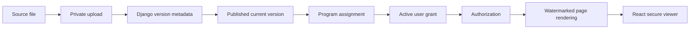
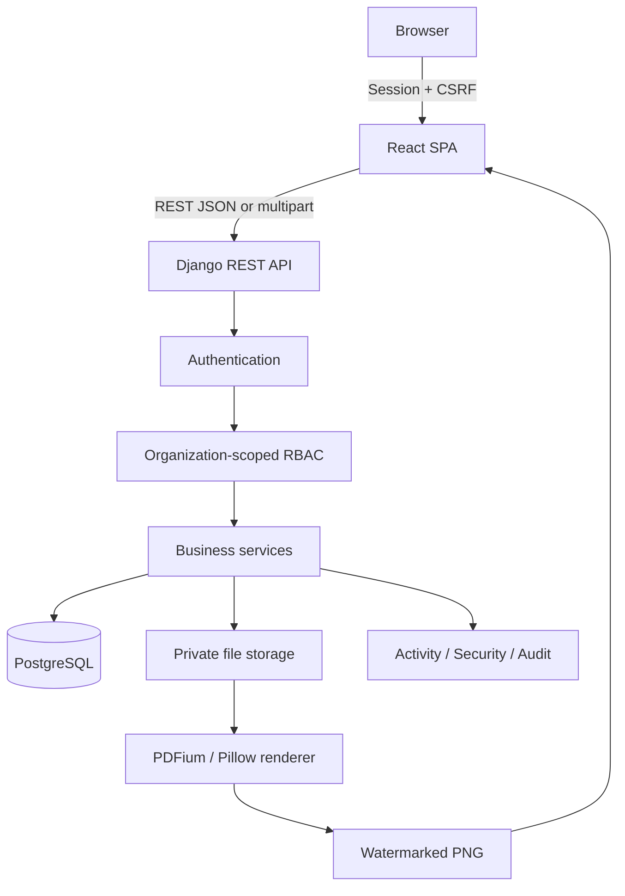

# CHAPTER 1

# INTRODUCTION

## 1.1 Overview of the Project

Organizations regularly create proprietary documents, presentations, policies, and learning materials. A common delivery practice is to share the original file or make it downloadable. This approach gives every authorized recipient broad control over the source artifact, even if the organization intended only temporary or monitored viewing.

AEGIS — Enterprise Knowledge Protection and Delivery Platform — is a web-based full-stack application developed by Princy W to govern knowledge at the organizational level. The project combines identity, role-based authorization, tenant isolation, content lifecycle management, controlled access, protected delivery, and accountability. It is intended to allow an authorized consumer to use content through the platform without receiving an unrestricted public source-file URL.

The system is structured around an Organization, referred to as a tenant, and treats organization membership as a fundamental resource boundary. A user belongs to one organization. Content, programs, roles, grants, activity, security events, and audit records are also organization-aware. A valid account and required permission do not alone make every action available; the backend additionally validates resource ownership and business state.

The project is implemented as an SPA using React and Vite, with Django REST Framework APIs and PostgreSQL persistence. Browser communication uses JSON or multipart data, Django session cookies, and CSRF protection. Django hosts the application API and, in development, private storage remains on the local filesystem behind server-side authorization.

**Figure 1.1. Traditional file-sharing problem**

The principal goal is not to replace document storage. It is to control the consumption path. The source remains private, while the system serves rendered pages according to the current session, permission, grant, assignment, version, and publication state.

## 1.2 Problem Statement

Traditional enterprise portals often separate uploading from controlled usage. A file is stored, and a download link or document service exposes its bytes to a user. Once the file has left the application boundary, the organization cannot consistently ensure that it remains associated with a specific user, program, or viewing context.

The project identifies these operational problems:

1. The source file may be available after it is no longer assigned or published.
2. A download URL may be shared independently of the user's permissions.
3. A user may consume content outside an approved program.
4. Viewer activity may not be linked to content, version, access grant, and session context.
5. Organizational data may not be isolated from another tenant.
6. Lifecycle changes may overwrite or erase historical version evidence.
7. Administrators may lack a readable record of user, content, security, and risk actions.

Table 1.1 summarizes the principal difference between the existing sharing approach and AEGIS.

| Existing sharing approach | AEGIS |
|---|---|
| Original file is downloaded | Source file remains private |
| Authorization is usually checked once | Viewer and page delivery are reauthorized |
| URL sharing bypasses user context | Session and organization context are required |
| Version changes overwrite history | Draft, published, and archived versions remain identifiable |
| Basic access logs may be separate | Activity, security, and audit records support accountability |
| One organization boundary is often implicit | Organization is a built-in tenant boundary |

**Table 1.1. Existing systems versus AEGIS**

## 1.3 Literature and Technology Survey

The project applies established concepts from web application security and software engineering rather than relying on a single proprietary product.

### 1.3.1 Django and Django REST Framework

Django provides an application framework, custom-user support, authentication helpers, ORM, migrations, session middleware, CSRF middleware, and administrative integration. Django REST Framework provides resource-oriented API views and a consistent JSON interface. The project uses the framework as an application boundary while keeping authorization decisions in backend services rather than only in templates or navigation controls.

### 1.3.2 React and the Single-Page Application Model

React organizes the interface into components and uses React Router for client-side paths. React 19 is used with Vite for development and production bundling. The frontend calls protected APIs with credentialed requests and centralizes CSRF and error handling in `src/api.js`. Frontend route and menu checks improve usability but do not replace backend authorization.

### 1.3.3 PostgreSQL and Relational Modeling

PostgreSQL stores relational application data. Django migrations describe the schema and constraints. Foreign keys establish ownership and association, while UUID primary keys reduce exposing predictable integer identifiers. Database constraints and model validation protect tenant consistency and lifecycle invariants.

### 1.3.4 Role-Based Access Control

RBAC maps effective permissions to users through organization roles. Permission rows represent operations such as viewing content, publishing versions, granting access, viewing audits, or reading organization analytics. The system roles include Administrator, Content Manager, Content Consumer, and Management. The role name is not treated as the sole security decision.

### 1.3.5 Secure Delivery and Watermarking

The secure viewer is server mediated. Supported PDFs are rendered through PDFium and raster images through Pillow. The backend creates PNG pages and overlays contextual text. It does not reveal a public source file URL. A consumer access record is created only after authorization and every page request repeats the grant and publication checks.

### 1.3.6 Activity and Audit

Activity events distinguish viewer opening and page rendering. Security events record security-relevant outcomes. Audit records describe changes in content, versions, programs, access, roles, users, and investigations. Append-only behavior is enforced at the application queryset level to support a dependable event trail.

### 1.3.7 Scope-Expansion Capabilities

The implemented scope is intentionally bounded. Risk signals are derived from existing access and denial records and are advisory. Investigations are tenant-scoped case records that reference approved audit or security evidence. Knowledge search retrieves and cites authorized content metadata; it does not extract document text, perform semantic vector search, or use a generative AI service.

## 1.4 Proposed System

AEGIS separates presentation, application logic, persistence, private storage, rendering, and operational evidence:

1. A user signs in using organization slug, email, and password.
2. Django authenticates the user in the organization context and creates a session.
3. The frontend requests CSRF state and the current user profile.
4. Backend permission decorators and service methods authorize operations.
5. The user creates or manages content and versions.
6. A version is uploaded to private storage and metadata is written to PostgreSQL.
7. The content manager groups content into programs and creates assignments.
8. A grant allows an eligible consumer to use a program for a limited or unbounded period.
9. The secure viewer validates content, assignment, grant, active status, and current published version.
10. PDF or image content is rendered as watermarked PNG pages.
11. Activity, security, audit, and access data are retained for monitoring.

**Figure 1.2. AEGIS proposed access model**

## 1.5 Objectives

| Objective | Practical implementation |
|---|---|
| Establish multi-tenant identity | Organization, tenant-scoped custom users, and organization-slug login |
| Enforce role-based authorization | Permission catalogue, system roles, effective permissions, backend checks |
| Protect source files | Private storage key and server-mediated rendering |
| Manage content lifecycle | Draft, publish, archive, and current-version behavior |
| Control program consumption | Assignments and active, revoked, or expired grants |
| Provide secure viewing | Revalidated consumer delivery and privileged preview separation |
| Track operational behavior | Viewer activities, access records, security events, and audit records |
| Support monitoring | Analytics, access reports, risk signals, and investigations |
| Restrict knowledge discovery | Permission-aware title and description retrieval |
| Produce reproducible evidence | Automated backend and frontend tests |

**Table 1.2. Project objectives**

## 1.6 Scope

The in-scope implementation includes organization management, tenant-scoped user administration, authentication, session and CSRF security, RBAC, content and version management, private uploads, programs, assignments, grants, secure PDF and image delivery, dynamic watermarking, activity and audit views, analytics, reports, risk signals, investigations, and metadata search.

Out-of-scope items include complete DRM, native mobile applications, offline encrypted viewers, enterprise identity federation, billing, distributed object storage, document text extraction, semantic vector retrieval, and generative AI.

| Scope category | Included in the project |
|---|---|
| Foundation | Organizations, custom users, sessions, CSRF, RBAC |
| Knowledge | Content metadata, versions, private storage, lifecycle |
| Access | Programs, assignments, grants, revocation, expiry |
| Delivery | PDF and raster image rendering, contextual watermark, reauthorization |
| Monitoring | Activity, security events, audit trail, analytics, reports |
| Scope expansion | Advisory signals, investigations, metadata knowledge search |
| Operations | PostgreSQL, Docker Compose database, migration and test scripts |

**Table 1.3. Project scope summary**

## 1.7 Organization of the Report

Chapter 1 introduces the project, problem, survey, proposed system, objectives, scope, and report organization.

Chapter 2 presents the Software Requirements Specification, including product description, roles, operating environment, constraints, functional and non-functional requirements, external interfaces, use cases, data flows, UML concepts, and data requirements.

Chapter 3 describes decomposition, dependencies, detailed design, database design, APIs, security design, test strategy, and test plan.

Chapter 4 presents implementation, screenshots placeholders, module-by-module results, test evidence, deployment state, and known limitations.

Chapter 5 concludes the work, summarizes outcomes, and identifies future enhancements.

References and appendices provide evidence, setup instructions, API examples, and supplementary material.
