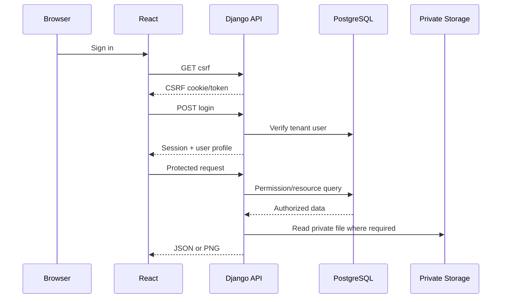
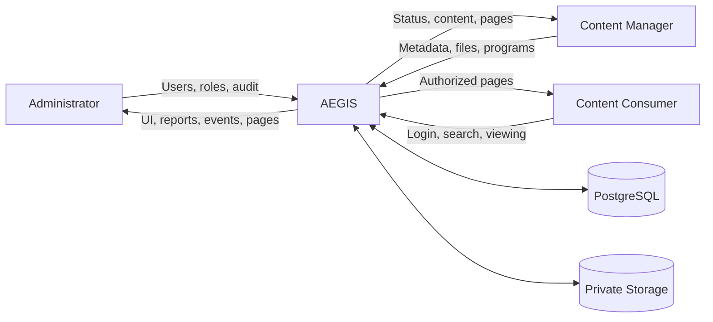
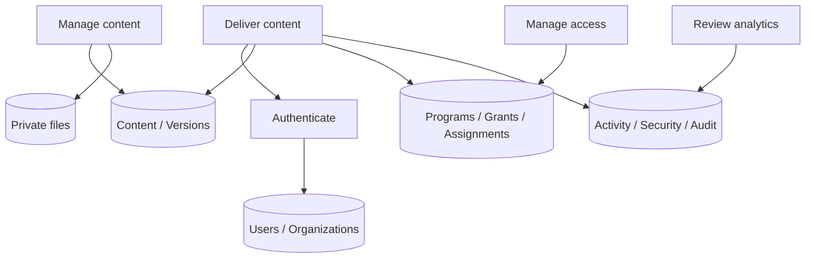
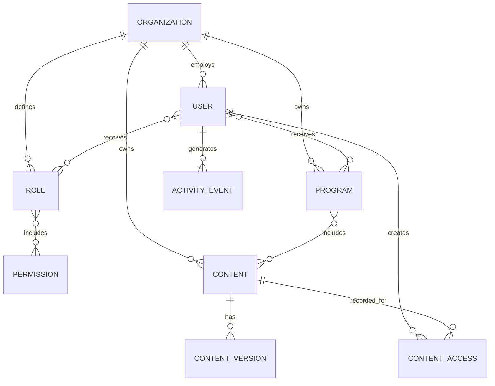

# CHAPTER 2

# REQUIREMENTS SPECIFICATION

## 2.1 Introduction

This chapter specifies the functional and non-functional requirements of AEGIS. Requirements are based on the existing project source, implementation documents, domain model, API specification, and automated test evidence. The implementation should be assessed against these requirements without assuming unimplemented capabilities.

## 2.2 Overall Description

AEGIS is a multi-organization knowledge protection and delivery platform. An organization is the tenant boundary. The application supports four principal operational roles with a configurable permission model.

| Role | Principal responsibilities |
|---|---|
| Administrator | Tenant administration, users, role/permission view, audit and broad organizational operations |
| Content Manager | Content, versions, uploads, publication, programs, assignments |
| Content Consumer | Search and consume only eligible assigned and granted content |
| Management | Read-oriented organization activity and reporting within assigned permissions |

**Table 2.1. Principal user roles**

### 2.2.1 Product Perspective

AEGIS is a stand-alone web product composed of a browser client and REST API. React communicates with Django. PostgreSQL stores domain and evidence metadata. Private storage holds source files. No external document intelligence or AI service is required in the implemented scope.

### 2.2.2 Product Functions

The functions of AEGIS are:

- organization-aware authentication and logout;
- user creation, update, activation and deactivation;
- role and permission inspection;
- content creation and lifecycle management;
- version upload and publication;
- program creation and activation;
- content assignment;
- program access grant issuance, expiration and revocation;
- consumer and privileged secure delivery;
- activity capture;
- audit, security event, risk and investigation review;
- analytics, access reports and metadata search.

### 2.2.3 User Characteristics

Users should be able to use a browser, navigate role-gated menus, read error messages, and upload supported files. Administrative users require knowledge of organizational roles and content lifecycle. Consumers require no technical expertise beyond using a controlled viewer.

## 2.3 Operating Environment

The development environment is a Windows or compatible workstation with Python 3.12, Node.js and npm, Docker for PostgreSQL, and a modern browser. The backend uses Django 5.2 and Django REST Framework. The frontend uses React 19 and Vite 7.

| Component | Version / Requirement |
|---|---|
| Browser | Modern Chromium, Firefox, Edge, or equivalent |
| Frontend | React 19, React DOM 19, React Router 7, Vite 7 |
| Frontend testing | Vitest 5, Testing Library, jsdom |
| Backend | Python 3.12, Django 5.2.18, Django REST Framework 3.18.1 |
| Database | PostgreSQL 16 through Docker Compose |
| Storage | Local private filesystem in development |
| Rendering | PDFium and Pillow |
| Other backend dependencies | psycopg binary, CORS headers, python-dotenv |

**Table 2.2. Hardware and software requirements**

The application requires network access between React and Django. The default development ports are 5173 for Vite and 8000 for Django. PostgreSQL is exposed on port 5432 for local development.

## 2.4 Constraints

- The backend requires environment variables for secrets and database settings.
- Source file storage is private and must not use public object URLs.
- Debug mode must not be enabled in production.
- Session authentication and CSRF controls must remain active.
- Public browser links do not establish authorization.
- Original published version metadata is immutable.
- PowerPoint and MP4 uploads may be accepted but are not rendered by the current secure viewer.
- The assistant is limited to title and description metadata.
- Tenant ownership must be validated independently of query parameters.

## 2.5 Specific Functional Requirements

| Requirement | Description |
|---|---|
| FR-01 | Authenticate with organization slug, email, and password |
| FR-02 | Obtain CSRF state and use Django sessions |
| FR-03 | List, create, update, activate or deactivate organization users |
| FR-04 | Display effective user roles and permissions |
| FR-05 | List organization roles and permission catalogue |
| FR-06 | Create content metadata in the authenticated organization |
| FR-07 | Upload and validate a draft content version |
| FR-08 | Publish a version and make it the current published version |
| FR-09 | Archive content or eligible versions |
| FR-10 | Create and manage programs and content assignments |
| FR-11 | Grant, revoke, expire or regrant program access |
| FR-12 | Start and deliver authorized secure content |
| FR-13 | Render PDFs and images as watermarked PNG pages |
| FR-14 | Record viewer and page activity |
| FR-15 | View organization activity, audit and security records |
| FR-16 | Create and update exposure-risk investigations |
| FR-17 | Generate advisory access-burst and repeated-denial signals |
| FR-18 | Return permission-aware content metadata search |
| FR-19 | Return organization analytics and access reports |

**Table 2.3. Functional requirements summary**

## 2.6 External Interface Requirements

### 2.6.1 User Interface

The interface contains a login page, sidebar navigation, overview dashboard, administration area, content library, programs, access management, secure viewer, accountability views, risk screens, knowledge search, analytics, and reports. Navigation is permission filtered, and errors are shown near the relevant operation.

### 2.6.2 API Interface

The API is mounted at `/api/v1/`. The resource groups include:

- authentication and current profile;
- users and roles;
- content and versions;
- programs and assignments;
- access grants and delivery;
- activities, audit, security, risk, and investigations;
- analytics and reports;
- knowledge assistant search.

**Table 2.5. Core API resource groups**

### 2.6.3 Hardware Interface

No specialized hardware interface is required. Supported operation depends on standard network access and browser rendering. Private storage depends on the local filesystem or a controlled future object-storage implementation.

### 2.6.4 Software Interface

The React interface depends on JSON and multipart HTTP. Django connects to PostgreSQL using psycopg and reads configuration through environment variables and `backend/.env`. Private file operations use Django filesystem paths. PDF and image rendering use PDFium and Pillow.

## 2.7 System Features

### 2.7.1 Authentication and Sessions

The login flow uses organization slug, email, and password. Authentication failures are generic. Account and source-IP rate limits reduce brute-force attempts. A session is created after successful authentication. Unsafe API requests require CSRF.

### 2.7.2 RBAC and Organization Isolation

Effective permissions are derived from role assignments. Organization ownership is enforced in querysets and service rules. A user is not allowed to resolve a resource by an ID belonging to another organization.

### 2.7.3 Content and Version Management

Content metadata has a lifecycle of Draft, Published, or Archived. Uploaded versions have a version number, status, storage key, original filename, MIME type, file size, checksum, creator, and timestamps. Published and archived version file identity remains immutable.

### 2.7.4 Programs and Access

A program belongs to an organization and contains content assignments. A Program Access Grant binds a user to a program and has active, revoked, or expired state. A consumer delivery requires an active grant, an active program, a valid assignment, and an active/published version.

### 2.7.5 Secure Delivery

The preview and consumer operations have separate contexts. A privileged preview is separate from normal consumer access and is audited. Every consumer page request checks eligibility again. Responses use private no-store delivery and do not expose the source path.

### 2.7.6 Accountability

Activity events capture viewer opening and page rendering. Security events capture security outcomes. Audit records retain append-only action evidence. Risk investigations reference existing evidence and maintain lifecycle, ownership, and update history.

## 2.8 Data Flow Diagrams

### 2.8.1 Context Diagram

**Figure 2.1. AEGIS system context diagram**

### 2.8.2 Level 1 Data Flow

**Figure 2.2. Level 1 data flow diagram**

## 2.9 Entity Relationship Concept

The central entity relationships are:

- Organization has many Users, Roles, Contents, Programs, and evidence records.
- User has many roles through a role assignment.
- Role has many permissions through role permissions.
- Content has many versions.
- Content belongs to one organization and can belong to many programs.
- Program has many content assignments and access grants.
- Content Access binds a user, content, version, and optional program.
- Activity and security records reference users and protected resources.
- Risk investigations reference tenants and approved evidence.

**Figure 2.3. Entity relationship concept**

## 2.10 Performance Requirements

- API list operations should support pagination.
- List pages should default to predictable page sizes and enforce maximum values.
- Authentication and content operations should give response feedback within a normal interactive web threshold.
- Large uploads should be size bounded by server validation.
- Organization and resource queries should use indexes and tenant predicates.
- Page delivery should be reauthorized rather than depending on a cache to grant access.
- Performance tests must distinguish application behavior from network and file-size effects.

## 2.11 Software Quality Attributes

| Attribute | Implementation and evidence |
|---|---|
| Security | Session authentication, CSRF, RBAC, tenant checks, private storage |
| Reliability | Database constraints, validation, immutable version identity, append-only audit rules |
| Maintainability | Django apps, service modules, React components, migrations, tests |
| Scalability | Stateless API design potential, pagination, indexed organization fields |
| Usability | Role-filtered navigation, consistent pages and errors |
| Traceability | Requirement, module, API, test, and architecture documents |
| Testability | Unit, integration, concurrency and frontend test suites |
| Portability | Environment variables, Docker database and framework dependencies |

**Table 2.4. Software quality attributes**
