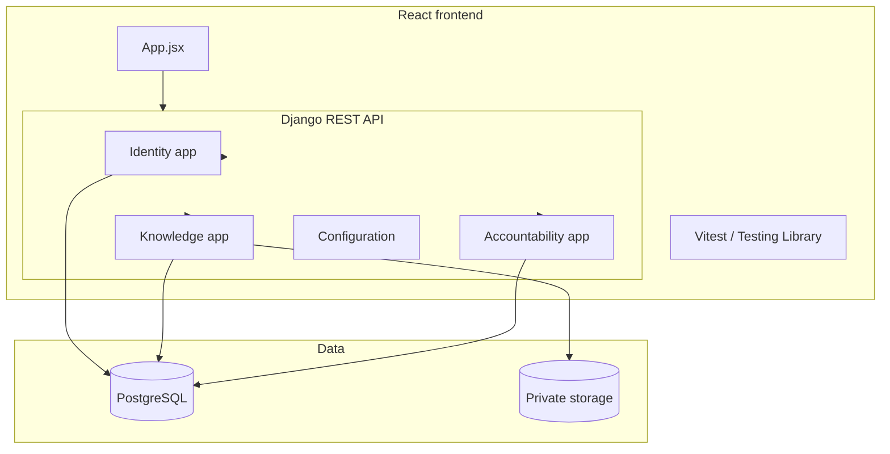
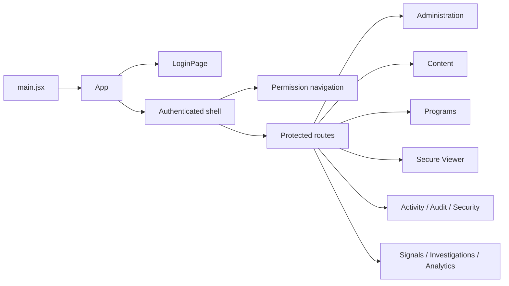
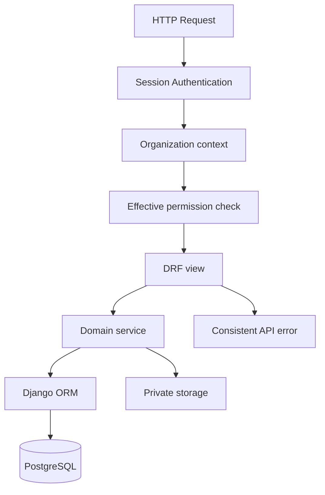
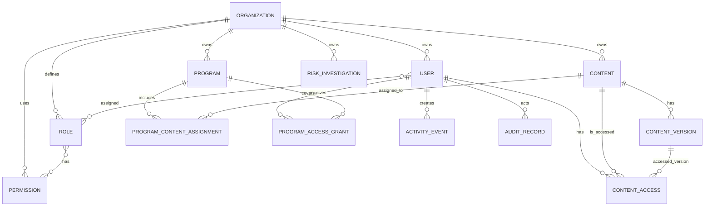
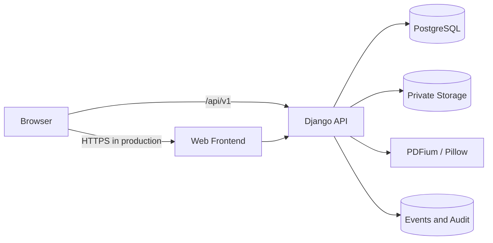
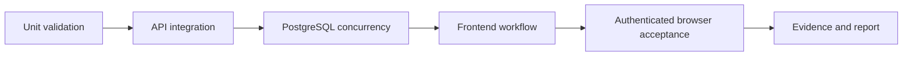

# CHAPTER 3

# SYSTEM DESIGN AND TEST PLAN

## 3.1 Decomposition Description

The application is divided into three Django domain applications and a React frontend. This separation keeps identity, accountability, and knowledge responsibilities clear.

| Module | Responsibilities |
|---|---|
| Identity | Organizations, custom users, roles, permissions, login, session profile, user administration |
| Knowledge | Content, versions, programs, assignments, grants, storage, viewer delivery, retrieval, analytics |
| Accountability | Activity, security events, audit records, login rate limits, risk investigations |
| React frontend | Routing, role-gated UI, API state, forms, viewer, reports |
| Configuration | URL mounts, environment settings, session and CSRF policy, CORS and REST behavior |

**Table 3.1. Decomposition of major application modules**

**Figure 3.1. High-level architecture**

## 3.2 Frontend Component Structure

The frontend entry point mounts the React application with a browser router. `App.jsx` defines authentication state and protected routes. `api.js` centralizes `/api/v1` requests, credentials, CSRF tokens, response parsing, pagination, and API error conversion.

Major screens include login, overview, administration, content, programs, access, secure viewer, activity, audit, security events, risk signals, investigations, assistant, analytics, and reports.

Navigation is filtered with permission codes. For example, a menu item may require `CONTENT_VIEW`, `PROGRAM_VIEW`, `AUDIT_VIEW_ORGANIZATION`, or another effective permission. The server independently repeats permission checks.

**Figure 3.2. Frontend component structure**

## 3.3 Backend Module Decomposition

The identity app owns the custom `User`, `Organization`, `Permission`, `Role`, and `RolePermission` entities. It also exposes authentication and administration APIs. The organization-aware backend uses a custom email backend.

The knowledge app owns content, versions, programs, assignments, access grants, access records, private storage, delivery, analytics, risk signals, and metadata retrieval.

The accountability app owns activity events, security events, audit records, login-throttling counters, risk investigations, and evidence validation.

**Figure 3.3. Backend module decomposition**

## 3.4 Dependency Description

Frontend dependencies are React, React Router, Vite, Vitest, Testing Library, and jsdom. Backend dependencies are Django, Django REST Framework, PostgreSQL driver, CORS headers, python-dotenv, Pillow, and PDFium. Docker Compose provides local PostgreSQL and persistent volume storage.

The API depends on the session middleware and CSRF middleware. Authentication depends on organization membership and password hashing. Authorization depends on effective role permissions and resource ownership. Secure delivery also depends on private storage, PDF/Image rendering, and revalidation services.

## 3.5 Detailed Design

### 3.5.1 Core Entity Design

| Entity | Key responsibilities |
|---|---|
| Organization | Tenant identity, lifecycle status, unique slug |
| User | Organization membership, email, password, status, names |
| Role | Named tenant role and permission collection |
| Permission | Unique operation code and description |
| Content | Organization-owned metadata and lifecycle status |
| ContentVersion | Immutable published file identity and version number |
| Program | Content grouping and active/inactive status |
| ProgramAccessGrant | User-to-program access, status, expiry and issuance |
| ContentAccess | Delivery attempt context and granted/denied result |
| ActivityEvent | Viewer open/page-render activity |
| SecurityEvent | Security outcome, severity and resource context |
| AuditRecord | Append-oriented administrative change evidence |
| RiskInvestigation | Tenant case, evidence, status, assignee and audit lifecycle |

**Table 3.2. Core entities and responsibilities**

### 3.5.2 Organization and Identity

`Organization` uses a UUID primary key and unique slug. `User` uses the Django custom-user model and belongs to an organization. Email uniqueness is scoped to organization and email. The authentication backend combines organization slug, email, password and active status.

Roles and permissions use a many-to-many relationship through `RolePermission`. Effective permissions are derived for the current user. The platform does not accept an arbitrary organization ID from a request as a replacement for authenticated tenant membership.

### 3.5.3 Content Version Design

Content is separate from ContentVersion. This lets a content title and metadata persist while its file evolves through version numbers. A version stores a private storage key, original name, MIME type, file size, lowercase SHA-256 checksum, creator and timestamps.

Publishing makes the selected version current and archives the previous current version. Published and archived versions prohibit changes to protected file identity and metadata fields. A draft can be updated according to the lifecycle rules.

### 3.5.4 Program and Access Design

Program content assignments link a program to a content item. Program Access Grants bind a user to a program. A grant may be active, revoked, or expired. Delivery checks active state, time range, program status, assignment state, content status, current published version, and user/organization context.

| Decision factor | Required state |
|---|---|
| User | Authenticated and active |
| Organization | Resource and user belong to the same tenant |
| Permission | Required operation permission is effective |
| Program | Active and organization-owned |
| Assignment | Content currently assigned to program |
| Grant | Active and within validity window |
| Content | Published |
| Version | Published and current |

**Table 3.3. Access and delivery decision factors**

### 3.5.5 Secure Delivery Design

The viewer first creates or obtains an access record. It validates consumer access and creates a contextual watermark from the user and access context. For PDF files, PDFium renders the requested page to an image. Pillow renders supported raster images and applies the watermark. Unsupported formats are not rendered by the secure viewer.

Each PNG page response is marked private and no-store. The original source is not sent to the browser. Page requests repeat reauthorization because a grant or assignment may have changed after the viewer opened.

### 3.5.6 API Error Design

The API has a common JSON error envelope for authentication, permission, validation, not-found, and CSRF failures. Frontend `ApiError` preserves status and code while constructing a readable message.

## 3.6 Entity Relationship Diagram

**Figure 3.7. Entity relationship diagram**

## 3.7 Deployment Architecture

In development, Docker Compose starts PostgreSQL 16 with an internal volume. Django runs separately at port 8000. Vite runs separately at port 5173 and proxies API communication. Private files live under `AEGIS_PRIVATE_STORAGE_ROOT` and are not volume-mapped as public web files.

**Figure 3.4. Deployment architecture**

Docker Compose in this repository is the database development configuration, not a complete production deployment. Production deployment would require HTTPS, a secure secret manager, controlled host configuration, durable private storage, backup, monitoring, and scheduled operations.

## 3.8 Test Plan

### 3.8.1 Unit Tests

Unit tests cover model validation, permission derivation, role assignment, password and login behavior, upload validation, storage paths, file checksums, lifecycle state, grant state, risk rules, and evidence validation.

| Category | Examples |
|---|---|
| Identity | Organization scope, login, user status, RBAC |
| Knowledge | Content lifecycle, versions, programs, grants, delivery |
| Accountability | Activity validation, audit append-only behavior, investigations |
| Frontend | Login form, navigation, administration, access and viewer UI |

**Table 3.4. Unit test categories**

### 3.8.2 Integration Tests

Integration tests submit API requests across authentication, permission, database, storage, and response boundaries.

| Area | Validation |
|---|---|
| Login | CSRF, organization resolution, session, inactive user, rate limit |
| Administration | Tenant directory, role catalogue, user creation and update |
| Knowledge | Upload, publish, assignment, grant, revoke and delivery |
| Evidence | Activity, audit, security events and risk investigations |
| Search | Permission and organization filtering |

**Table 3.5. Integration test plan**

### 3.8.3 System and Acceptance Tests

System tests verify complete workflows with synthetic data. Acceptance work is not complete until the browser screens are captured and reviewed with approved synthetic accounts.

| Test scenario | Expected result |
|---|---|
| Successful organization login | Authenticated session and role menu |
| Wrong password | Generic failure and optional rate limit |
| User from another tenant | Organization resources remain inaccessible |
| Consumer with no grant | Viewer denied |
| Consumer with assignment and grant | Current published page delivered |
| Grant revoked during viewing | Subsequent page denied |
| Privileged preview | Renders when preview permission exists and does not create consumer access |
| Draft version | Not eligible for normal delivery |
| Published version | May become eligible when all access rules pass |
| Investigation creation | Valid evidence and organization ownership recorded |

**Table 3.6. System test and acceptance plan**

**Figure 3.8. Test strategy**

### 3.8.4 Test Exit Criteria

The test cycle is complete only when migrations apply without drift, backend tests pass on a disposable PostgreSQL database, frontend tests pass, the production bundle builds, security-sensitive cases are accepted manually, and any remaining limitations are recorded.
