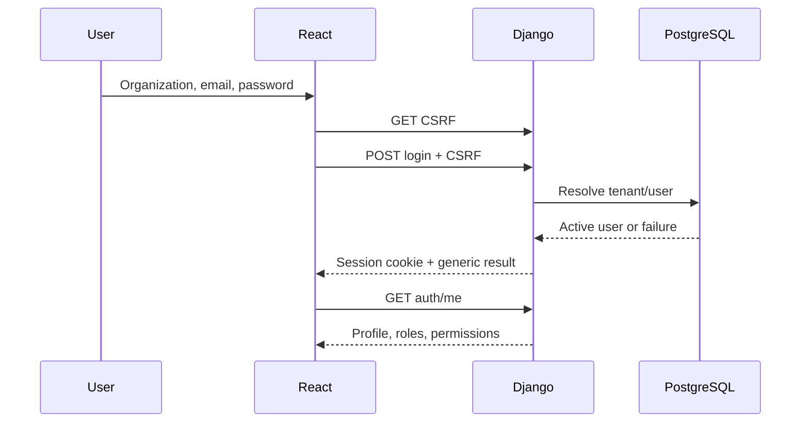
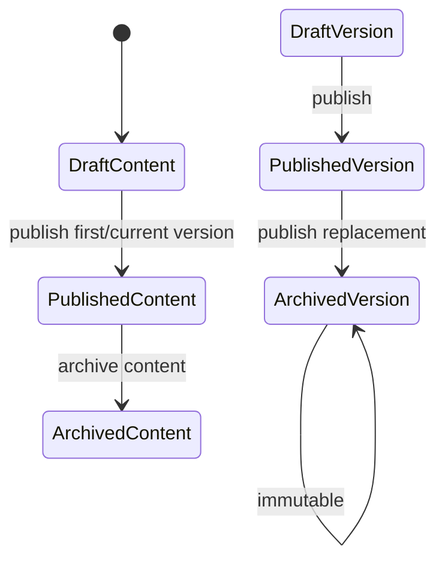
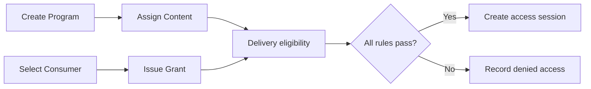
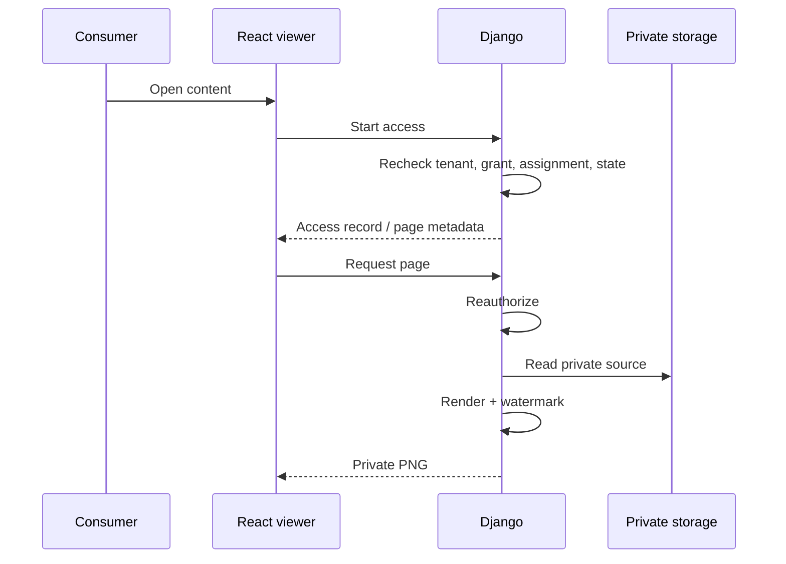
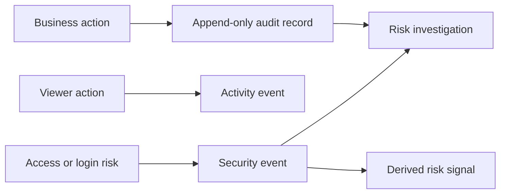

# CHAPTER 4

# IMPLEMENTATION AND RESULTS

## 4.1 Technology Implementation

The application was implemented as a React frontend and Django REST backend connected to PostgreSQL. Private files are kept out of the public web layer and transformed to watermarked pages by server components.

| Layer | Implemented technology |
|---|---|
| Presentation | React 19, React Router 7, Vite 7 |
| API | Django 5.2.18, Django REST Framework 3.18.1 |
| Identity | Django custom user, session authentication, organization email backend |
| Persistence | PostgreSQL 16 and Django ORM/migrations |
| Storage | Organization-content-version private filesystem layout |
| Rendering | PDFium for PDF pages and Pillow for raster images |
| Local infrastructure | Docker Compose PostgreSQL |
| Frontend testing | Vitest, Testing Library, jsdom |
| Backend testing | Django test runner |

**Table 4.1. Technology stack**

## 4.2 Implementation Milestones

| Milestone | Result |
|---|---|
| M0 Foundation | Project structure, Django settings, React package, Docker Compose and private storage baseline |
| M1 Identity | Organization and custom User models, tenant email uniqueness |
| M2 Authentication | Organization login, sessions, CSRF, generic failures and login throttling |
| M3 RBAC | Roles, permissions, effective permission and administration APIs |
| M4 Content | Content metadata lifecycle and API workflow |
| M5 Versioning | Private upload, checksum, publish/archive and immutable version behavior |
| M6 Programs | Programs, assignments and organization status |
| M7 Access | Program Access Grants, expiry, revoke and regrant behavior |
| M8 Secure Delivery | Consumer access, page rendering, watermark and activity |
| M9 Security Hardening | Tenant and storage checks, preview separation and event evidence |
| M10 Accountability | Activity, security, audit and investigation APIs |
| M11 Scope A | Advisory access-burst and repeated-denial risk signals |
| M12 Scope B | Exposure-risk investigation workflow and evidence validation |
| M13 Scope C | Permission-aware title/description knowledge search |
| M14 Consolidation | Analytics, reports, user manual and implementation verification |

**Table 4.2. Implemented milestone summary**

## 4.3 Authentication and Session Implementation

The login page sends organization slug, email and password to `POST /api/v1/auth/login/`. The frontend first obtains `/auth/csrf/` for unsafe requests. The backend organization-email authenticator resolves the organization and user together. The resulting Django session is HttpOnly; the CSRF cookie follows the configured secure and SameSite settings.

`GET /api/v1/auth/me/` returns organization, role and effective permission data. React uses this response for navigation and the current workspace. It does not use the response as an authorization boundary; all protected endpoints repeat backend checks.

**Figure 4.1. Login flow**

## 4.4 Administration Implementation

The administration interface supports tenant organization users, role/permission visibility, user creation and role assignment at creation, and permitted activation or deactivation. A one-time temporary password may be returned after creation and must be delivered through an approved channel.

Emails are organization scoped. A role can contain multiple permissions. User status and effective permissions are used when building the current profile.

## 4.5 Content and Version Implementation

The content library enables title and description creation, metadata search, version upload, draft storage, publication and archive operations. Uploaded files are checked for type, size and checksum. The private storage key is derived from organization, content and version IDs.

**Figure 4.2. Content publication and version flow**

Published version metadata and file identity cannot be modified through normal saves. Replacing a published version requires a new version. The old current published version is archived in the publication workflow.

## 4.6 Programs and Access Implementation

Programs are organization-owned containers for content. Managers add or remove assignments and can activate or deactivate a program. Grants are separate records binding a user to a program. The user, grant, program and assignment must belong to the authenticated tenant context.

**Figure 4.3. Program assignment and grant flow**

A grant has explicit ACTIVE, REVOKED or EXPIRED status. Revocation or expiry does not erase its history. A subsequent delivery request revalidates the latest state.

## 4.7 Secure Viewer Implementation

The secure viewer starts after an access request. A privileged preview uses `PREVIEW` context and `CONTENT_PREVIEW` authorization, and it does not create consumer authorization. Normal consumer delivery uses `CONSUMER` context and requires grant and assignment eligibility.

Supported PDFs are rendered through PDFium. Raster images are rendered through Pillow. The server produces watermarked PNG pages. The response is private/no-store and does not provide the original source URL.

**Figure 4.4. Watermarked delivery flow**

PowerPoint and video files may pass upload validation subject to configured limits, but the current viewer does not render them. This limitation is disclosed in the user manual and viva evidence.

## 4.8 Accountability and Monitoring Implementation

Activity events distinguish viewer opening and page rendering. Security events carry severity and resource context. Audit records preserve organization, actor, action and timestamp evidence.

**Figure 4.5. Audit and monitoring flow**

Risk signals are advisory and derive ACCESS_BURST and REPEATED_DENIALS information from existing records. Investigations are audited case workflows that reference approved evidence.

## 4.9 Analytics and Knowledge Search Implementation

Analytics aggregate activity for organization or assigned scope. The dashboard reports content views, active users and most-viewed content when permitted. Reports expose access information with organization-aware filtering.

The knowledge assistant searches live `Content.title` and `Content.description` values. The endpoint requires search and view permissions and returns metadata citations. It does not index file text or use a generative model.

## 4.10 Verification Results

The latest recorded backend verification reported 174 Django tests passing in a disposable PostgreSQL test database. The suite destroyed the test database after execution and demonstrated migration and ORM behavior.

| Verification item | Recorded result |
|---|---|
| Django system check | Passed |
| Migration drift check | No changes reported |
| PostgreSQL backend suite | 174 tests passed |
| Delivery suite | 11 tests passed on disposable PostgreSQL |
| Delivery, analytics and risk subset | 43 tests passed |
| SQLite development suite | Passing, but not evidence for PostgreSQL concurrency |
| Frontend | 23 Vitest tests passed across two files |
| Frontend build | Vite production build succeeded |

**Table 4.3. Backend verification summary**

The latest frontend evidence comprised login, route, administration, access, and workflow tests in `App.test.jsx` and API behavior tests in `api.test.js`.

| Frontend evidence | Result |
|---|---|
| Login and 429 handling | Passed |
| Administration and access workflows | Passed |
| API CSRF and session behavior | Passed |
| Production bundle | Passed |

**Table 4.4. Frontend verification summary**

### 4.10.1 Module Status

| Module | Status |
|---|---|
| Login/session | Implemented and tested |
| RBAC/user administration | Implemented and tested |
| Content/versioning | Implemented and tested |
| Programs/assignments/grants | Implemented and tested |
| Secure PDF/image delivery | Implemented and tested |
| Privileged preview | Implemented and tested |
| Activity/audit/security | Implemented and tested |
| Risk signals/investigations | Implemented and tested |
| Metadata knowledge search | Implemented and tested |
| Analytics/reports | Implemented and tested |
| Authenticated browser screenshots | Outstanding |

**Table 4.5. Module implementation status**

## 4.11 Results and Observations

The implementation demonstrates that organization, permission, program, grant and current-version rules can be combined to decide whether a viewer can consume a resource. It also demonstrates server-mediated page rendering rather than public file access.

The PostgreSQL concurrency tests confirmed login account and source-IP rate-limit counters use database row locking and isolate their thresholds. The frontend tests confirm login submission and role-filtered pages, but do not prove every visual layout under all browser configurations.

No conventional ML dataset or model is used. The risk capabilities operate from normal application records, and retrieval operates over content metadata. Therefore, accuracy claims must remain descriptive rather than statistical.

## 4.12 Limitations

- Authenticated screenshots are not committed as genuine browser evidence.
- The private storage implementation is local filesystem storage; an object-storage adapter is not the baseline.
- Docker Compose does not represent a complete production deployment.
- Secure viewer conversion supports PDFs and raster images, not PPTX or MP4 playback.
- Search is metadata-only and does not perform semantic or generative retrieval.
- Risk signals are advisory and do not deny access.
- The repository may not contain a production secret manager or external monitoring service.
- Future browser and deployment acceptance may identify accessibility or compatibility differences.
