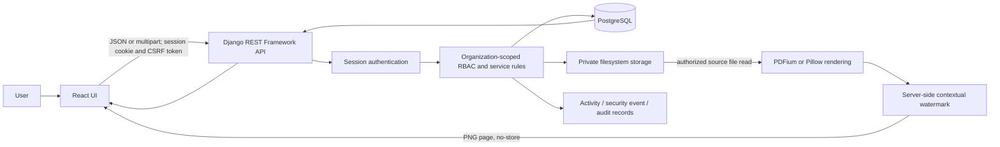

# AEGIS — Second Review Report

## 1. Title of the Project

**AEGIS — Enterprise Knowledge Protection and Delivery Platform**

This report documents the implementation found in the repository at the time
of review. No student, institution, supervisor, or submission-date details are
added because those details were not verified in the project files.

## 2. Work Completed So Far

### 2.1 Overall System Design

AEGIS is an organization-scoped web application with a React single-page
interface, a Django REST Framework API, PostgreSQL persistence, and private
filesystem storage for version files. The implementation uses Django's
session-authentication and CSRF mechanisms. Backend permissions and
organization-scoped querysets decide access; hiding a link in React is only a
user-interface convenience.

The implemented design covers:

- Organization-scoped identities, roles, permissions, and user administration.
- Content metadata, file upload, immutable published version data, publication,
  archival, Programs, content assignments, and Program Access Grants.
- A controlled viewer that returns rendered, watermarked PNG pages after
  authorization, rather than a file URL.
- Operational viewer activity, security events, append-only application-level
  audit records, analytics, and reports.
- Three approved scope-expansion capabilities, with important limits:
  - **A — Context-aware access-policy scope:** implemented as explainable,
    advisory risk signals. Signals do not change authorization.
  - **B — Content Exposure Risk Investigation:** persisted, tenant-scoped cases
    with validated evidence references and audit integration.
  - **C — Permission-aware assistant scope:** live metadata retrieval and
    citations only. It is not semantic document retrieval, generative RAG, or
    an AI assistant.

The actual request path is summarized below.

This is the implemented local architecture, not a claim that an object-storage
service, vector store, AI provider, queue, or production SaaS deployment is
present. Source evidence includes `frontend/src/App.jsx`, `frontend/src/api.js`,
`backend/config/settings.py`, `backend/config/api_urls.py`,
`backend/knowledge/storage.py`, `backend/knowledge/delivery.py`, and
`docker-compose.yml`.

### 2.2 Dataset and Test Data

AEGIS does not use a conventional machine-learning training or evaluation
dataset. There is no model-training pipeline in the inspected code.

The application stores operational records: Organizations, Users, Roles,
Permissions, Content, Content Versions, Programs, Assignments, Program Access
Grants, Content Access, Activity Events, Security Events, Audit Records, and
Risk Investigations. Uploaded file bytes are held by the private filesystem
storage service; PostgreSQL stores their version metadata, storage key, size,
MIME type, and SHA-256 checksum.

No committed sample-content dataset or external source dataset was identified
in the inspected implementation. The automated tests create synthetic users,
organizations, content metadata, events, grants, assignments, and file
fixtures. The `seed_rbac` management command seeds the permission catalogue
and standard organization roles; it is not a content-data import.

The risk rules consume normal application records; the retrieval capability
searches Content titles and descriptions. Neither uses training data. Limitations
include the absence of labeled security events for real-world precision/recall
evaluation and the absence of a labeled query set for metadata relevance
evaluation.

### 2.3 Modules Completed with Screenshots

The repository contains implementation for the modules listed below. The
evidence references identify where to inspect them. Screenshots of authenticated
workflows are **not included**: the available browser session was unauthenticated,
and no approved synthetic-content demonstration session was available for
capturing those screens. No mockups or fabricated screenshots are presented as
implementation evidence.

| Module | Implemented workflow | Source and test evidence | Screenshot state |
|---|---|---|---|
| Login and session | Organization slug, email, password; CSRF-protected session login/logout | `backend/identity/views.py` (`LoginView`, `LogoutView`); `backend/identity/tests.py` | Capture manually with synthetic account |
| Administration | Tenant-scoped user listing/creation/update, role assignment at creation, role and permission catalogue | `backend/identity/views.py`; `backend/identity/serializers.py`; `backend/identity/tests_admin_api.py` | Capture users, roles, and one-time credential flow with synthetic account |
| Content and versions | Create metadata, upload draft versions, publish and archive supported lifecycle objects | `backend/knowledge/views.py`; `backend/knowledge/services.py`; `backend/knowledge/tests.py`; `tests_uploads.py` | Capture content detail and version history |
| Programs and assignments | Create/manage Programs and attach/remove Content | `backend/knowledge/views.py` (`Program*` views); `backend/knowledge/services.py`; `tests_programs.py` | Capture Program assignment |
| Access grants | Grant, expire, revoke, and regrant Program access for Content Consumers | `backend/knowledge/services.py`; `tests_access_grants.py` | Capture grant and revoked status |
| Secure viewer | Start a consumer access session and request rendered pages; every page rechecks eligibility | `backend/knowledge/delivery.py`; `backend/knowledge/views.py`; `tests_delivery.py` | Capture with synthetic PDF and authorized consumer |
| Privileged preview | Separate operator preview permission; preview neither grants consumer access nor assigns content | `backend/knowledge/delivery.py`; `docs/adr/0011-privileged-content-preview.md`; `tests_delivery.py` | Authenticated acceptance still required |
| Activity, security events, audit | Read-only, permission-filtered event views and mutation audit history | `backend/accountability/models.py`, `views.py`, `services.py`; `tests_m10.py`, `tests_hardening.py` | Capture with synthetic events |
| Analytics and reports | Successful consumer opens, daily grouping, per-version counts, access report | `backend/knowledge/analytics_views.py`; `tests_analytics.py` | Capture with seeded synthetic views |
| Capability A | Advisory access-burst and repeated-denial signal review | `backend/knowledge/risk_signals.py`; `backend/accountability/views.py`; `tests_risk_and_assistant.py` | Capture only after synthetic activity is arranged |
| Capability B | Investigation list, create/detail/edit, lifecycle, evidence and audit | `backend/accountability/views.py`, `evidence.py`; `tests_risk_and_assistant.py` | Capture with synthetic evidence |
| Capability C | Permission-filtered title/description search and metadata citations | `backend/knowledge/retrieval.py`; `backend/knowledge/views.py`; `tests_risk_and_assistant.py` | Capture with synthetic authorized Content |

**Manual screenshot checklist:** capture (1) login with no credentials entered,
(2) Organization users and role catalogue, (3) Content detail/version history,
(4) Program and assignment, (5) consumer grant/revocation, (6) protected viewer
with visible watermark, (7) Activity/Audit, (8) Analytics/Reports, and
(9) Risk signals, Investigations, and Knowledge search. Use synthetic data;
exclude passwords, cookies, tokens, real personal information, and protected
enterprise content. Record screenshot date and account role, and link only
screens that were actually captured and reviewed.

### 2.4 Pseudocode for Incomplete Modules

No pending baseline MVP module was identified in the inspected implementation
and current implementation-status record. Pseudocode is therefore not supplied.
The following are **scope limitations or acceptance gaps**, not claims that an
MVP pseudocode stub exists:

- Capabilities A and C are limited to the approved v1 advisory/metadata scope.
- Authenticated browser/manual acceptance for the UI flows remains unrecorded.
- PowerPoint and video files can pass upload-format validation but are not
  rendered by the protected viewer, whose supported formats are PDF and raster
  images.
- Organization profile/configuration editing is not exposed by the current API
  contract.

### 2.5 Scope Expansion Following First-Review Feedback

The approved scope-expansion task frames the review questions as the need to
explain AEGIS's contribution beyond general content management, the problem it
addresses, and its AI scope. The response was a controlled extension, not a
replacement of the baseline architecture. Its technical contribution is the
integration of explainable operational signals, evidence-preserving
investigations, and retrieval constrained by current AEGIS permissions.
It is not a claim that AEGIS is the first or only product with those
capabilities.

#### Capability A — Context-Aware Content Access Policies

- **Problem:** operators need a review cue when existing access or denial
  activity has a noteworthy pattern.
- **Implementation:** `backend/knowledge/risk_signals.py` analyzes existing
  consumer `ContentAccess` and normal `ACCESS_DENIED` `SecurityEvent` rows.
  It derives `ACCESS_BURST` for at least four successful consumer opens across
  at least three distinct Content IDs in a rolling 24-hour interval and
  `REPEATED_DENIALS` for at least three content denial events for a known user
  in a rolling 24-hour interval.
- **Inputs/outputs:** existing timestamped, tenant-scoped events in; a
  request-time list/summary of signal type, configured severity, counts,
  timestamps, user identifier, and explanation out.
- **Integration/novelty:** reuses the current event, delivery, permission, and
  React review systems. The contribution is explainable monitoring attached to
  the existing authorization context, not a new authorization engine.
- **Validation:** backend tests exercise source records, thresholds, time
  bounds, filters, permissions, tenant isolation, and unchanged grant/access
  state.
- **Limitations:** rules and severity values are implementation behavior, not
  independently approved product policy. No labeled-data precision/recall
  evaluation exists. Signals do not grant, deny, suspend, or revoke access.

#### Capability B — Content Exposure Risk Investigation

- **Problem:** an operator needs a traceable case to record and review observed
  security concerns without modifying their source events.
- **Implementation:** existing `RiskInvestigation` rows retain status,
  severity, notes, and bounded `{type, id}` references to supported
  organization-scoped Security Events/Audit Records. `evidence.py` validates
  current source existence, source-specific permissions, type, UUID, tenant,
  duplicates, and the 25-reference limit; serialization resolves references
  under current permissions.
- **Inputs/outputs:** authorized case text, status/severity, and evidence
  references in; a case with current visible evidence details and audit history
  out. `OPEN` can move to `IN_REVIEW` or `DISMISSED`; `IN_REVIEW` can move to
  `RESOLVED` or `DISMISSED`; `RESOLVED` and `DISMISSED` are terminal and
  read-only.
- **Integration/novelty:** reuses `RiskInvestigation`, immutable source records,
  `AuditRecord`, RBAC, and React. The contribution is the governed evidence
  workflow, not AI incident attribution.
- **Validation:** tests cover status combinations, tenant and permission
  enforcement, evidence validation/read-time visibility, and transaction
  rollback when audit recording fails.
- **Limitations:** no automatic case creation, chronological joined evidence
  timeline, AI summary, or claim of confirmed breach. The UI selector exposes
  only the first 100 currently visible denial events; Audit Record attachment
  is API-supported but not offered by that selector. Terminal case corrections
  require a new case.

#### Capability C — Permission-Aware Enterprise Knowledge Assistant

- **Problem:** let a user find currently authorized Content through a
  convenient search while maintaining the existing role, tenant, assignment,
  grant, publication, and version checks.
- **Implementation:** `POST /api/v1/assistant/query/` searches case-insensitive
  substrings in authorized Content titles/descriptions, returns at most five
  title-ordered matches and source metadata, and validates a 1–200 character
  non-whitespace query.
- **Inputs/outputs:** one `question` string; a fixed retrieval-status message,
  authorized metadata citation list, and `insufficient_authorized_sources`
  boolean. No generation occurs.
- **Integration/novelty:** reuses Content, current ContentVersion, Program,
  assignment, ProgramAccessGrant, RBAC, and the existing React API client.
  The technical contribution is live permission-aware metadata candidate
  selection, not semantic retrieval.
- **Validation:** tests cover missing permissions, tenant isolation,
  grant/assignment/program/current-version state, source eligibility, citation
  visibility, result bounds, invalid input, and no access-state mutation.
- **Limitations:** no document-body extraction, chunks, embeddings, vector
  store, model, source passage citations, or generative answer. No labeled
  relevance evaluation exists.

### 2.6 AI Scope

No AI/ML model, model API, embedding library, vector database, AI provider, or
training dataset is present in the inspected dependency manifests or feature
code. Capabilities A and C are deterministic queries/rules. Capability B is a
human evidence workflow. The assistant UI includes fixed text clarifying that
it does not search document contents or generate answers. Future generative
RAG requires a separate design and approval.

## 3. Test Cases

The backend command below was run during this review from `backend/`; Django
created and destroyed its test database. Result: **174 tests passed in
419.723 seconds**, no reported test failures or skips; Django reported no
system-check issues except one configured silenced check. Frontend evidence
from the latest recorded run is **23 tests passed across two files** and a
successful production build. These are automated results, not authenticated
browser acceptance.

| Test ID | Module | Test scenario and evidence | Preconditions / execution | Expected result | Actual result | Status |
|---|---|---|---|---|---|---|
| T01 | Authentication | Valid organization/email/password; `identity/tests.py` | Synthetic user and organization | Session established and correct tenant user returned | Covered by current identity suite | Passed |
| T02 | Authentication | Invalid password or unknown organization; `identity/tests.py` | No valid matching identity | Generic unauthorized response; no organization/account disclosure | Covered by current identity suite | Passed |
| T03 | Authentication | Inactive user cannot authenticate; `identity/tests.py` | User status `INACTIVE` | Authentication denied | Covered by current identity suite | Passed |
| T04 | Rate limiting | Account/IP threshold, rolling-window and PostgreSQL concurrency tests; `accountability/tests.py` | PostgreSQL test database | Limits are atomic and generic failures returned | Included in 174-test run | Passed |
| T05 | RBAC | Role grants and denied action; `identity/tests_rbac.py` | Seeded test roles | Only effective tenant permissions authorize action | Included in 174-test run | Passed |
| T06 | Tenant isolation | Cross-organization user/content/role lookup; identity, program, and access tests | Two test organizations | No cross-tenant record is returned or mutated | Included in 174-test run | Passed |
| T07 | User administration | Create, audit, tenant-scoped role choice, duplicate email, deactivation; `identity/tests_admin_api.py` | Authorized administrator | Valid change succeeds, unauthorized deactivation denied | Included in 174-test run | Passed |
| T08 | Upload | Extension, declared MIME, file signature, size and PPTX package checks; `knowledge/tests_uploads.py`, `tests.py` | Synthetic uploaded files | Invalid uploads rejected before protected use | Included in 174-test run | Passed |
| T09 | Storage | Private URL, tenant-scoped storage key, checksum/size, duplicate and traversal tests; `tests_storage.py` | Temporary filesystem | No public URL/traversal; metadata matches bytes | Included in 174-test run | Passed |
| T10 | Content/version | Version numbering, publishing, old-current archival, immutability and audit rollback; `knowledge/tests.py` | Synthetic content/version rows | Lifecycle rules and transaction consistency hold | Included in 174-test run | Passed |
| T11 | Program/assignment | Assignment create/remove, duplicate conflict, inactive Program; `tests_programs.py` | Authorized Content Manager | Only valid tenant assignments are created | Included in 174-test run | Passed |
| T12 | Grants | Grant, expiry, revoke, regrant, role restriction; `tests_access_grants.py` | Active consumer and Program | Current access state controls consumer eligibility; history retained | Included in 174-test run | Passed |
| T13 | Secure delivery | Per-page grant, assignment, publication, current-version and tenant rechecks; `tests_delivery.py` | Synthetic authorized session | PNG only after each request's checks | Included in 174-test run | Passed |
| T14 | Watermark | Rendered PDF/image page watermark, headers and page errors; `tests_delivery.py` | Synthetic content | Watermarked PNG, no source file URL/bytes | Included in 174-test run | Passed |
| T15 | Preview | Preview permission, active user, tenant, owner, lifecycle and no-grant invariant; `tests_delivery.py` | Administrator/Manager role fixtures | Separate operator preview; consumer rules unchanged | Included in 174-test run | Passed |
| T16 | Activity/audit | Tenant views, read-only APIs, ORM append-only audit checks; `tests_m10.py`, `tests_hardening.py` | Synthetic events | Visibility follows permission and source rows are not changed | Included in 174-test run | Passed |
| T17 | Analytics/reports | Assigned/organization scope, counts, filters, preview exclusion; `tests_analytics.py` | Synthetic access records | Aggregations and filter boundaries match access rows | Included in 174-test run | Passed |
| T18 | Capability A | Rule thresholds, rolling interval, denial event source, tenant and no state mutation; `tests_risk_and_assistant.py` | Synthetic accesses/events | Correct advisory signal only | Included in 174-test run | Passed |
| T19 | Capability B | Status transitions, evidence scope, read-time permission, audit rollback; `tests_risk_and_assistant.py` | Synthetic evidence | Only allowed transitions and authorized evidence | Included in 174-test run | Passed |
| T20 | Capability C | Grants, assignments, current versions, query validation, citations, result limit; `tests_risk_and_assistant.py` | Synthetic Content and roles | Only authorized metadata returned; no writes | Included in 174-test run | Passed |
| T21 | Frontend | Login, grant, investigation, preview, metadata retrieval UI behavior; `frontend/src/App.test.jsx` | Vitest/jsdom | UI sends expected requests and renders state/errors | 23 tests passed in latest recorded frontend run | Passed |
| T22 | Production bundle | `npm run build` from `frontend/` | Installed frontend dependencies | Vite production assets build | Successful in latest recorded build | Passed |
| T23 | Authenticated browser review | Manually verify all pages/screens and role behavior | Authorized test accounts and synthetic files required | Screens and flows visually confirmed | Not run; no authenticated session available | Not Verified |
| T24 | Manual preview acceptance | G13 in `docs/implementation-setup.md` | Administrator/Content Manager and synthetic PDF/image | Verify watermark, audit/activity, no grant/assignment change | Not run | Not Verified |

**Overall automated result:** the 174-test backend suite passed in the current
review; the last recorded frontend test and build runs passed as stated above.
No authenticated manual acceptance is claimed.

## 4. Deviations, If Any, and Justification

No approved architectural deviation was identified for Capabilities A, B, or C.
The documented and implemented limits are deliberate scope decisions:

- A is advisory rather than a contextual authorization engine.
- B uses existing organization-scoped evidence and audit systems.
- C is retrieval-only metadata search, not generative RAG.
- The separate `CONTENT_PREVIEW` permission, preview context, renderer reuse,
  and independent route follow ADR-011; they do not grant consumer delivery.

There are, however, **verification gaps and implementation limitations** to
present transparently: authenticated browser acceptance remains pending;
product approval/evaluation of A's thresholds and severities is not established;
the local security example template contains non-placeholder-looking
development configuration values and should not be treated as production
configuration; and the current login backend does not consult the
Organization lifecycle status despite that field existing in the model. The
last two findings are recommendations for project-owner review, not changes
made in this documentation task.

The Organizations status field (`ACTIVE`, `SUSPENDED`, `ARCHIVED`) is modeled,
but the inspected authentication backend filters by slug/email and active User,
not Organization status. Whether a suspended/archived Organization must block
authentication is **not verified as an approved product rule**. Do not claim
that organization lifecycle enforcement exists until this is resolved.

## 5. Conclusion

AEGIS implements a functional organization-scoped content governance and
controlled-delivery MVP. Its verified contribution is the integration of
tenant-aware RBAC, versioned private content, per-request delivery checks,
rendered page watermarks, access/activity/audit evidence, and scoped analytics.
The post-review capabilities add deterministic advisory risk signals, a
human-controlled evidence investigation workflow, and permission-aware
metadata retrieval.

The source and the executed automated test suite support those implementation
claims. They do **not** support claims of absolute DRM, screenshot prevention,
machine-learning anomaly detection, semantic document retrieval, LLM-generated
answers, statistically validated risk thresholds, or authenticated manual
acceptance. The next review preparation step is to run the documented
synthetic-data demonstrations, capture genuine screenshots, and record the
outcomes. Resolve the organization-lifecycle policy and replace local
development configuration values before any non-local deployment.